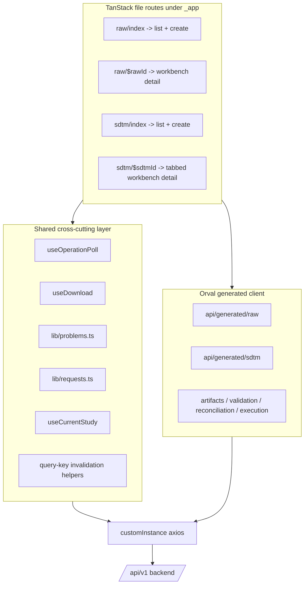
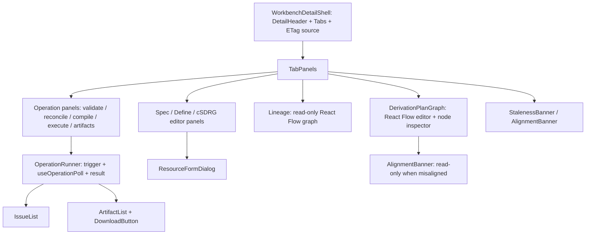

# Design Document

## Overview

This feature delivers the browser-facing authoring, viewing, and artifact-generation experience for the Raw and SDTM modules of the Clinical Artifact Platform. It extends the existing React 18 + TypeScript + Vite single-page app in `frontend/` from the current minimal aggregate-list placeholders (`_app/raw.tsx`, `_app/sdtm.tsx`) into full list-plus-detail workflows that cover every Raw and SDTM HTTP surface the Phase 3 backend exposes.

The design is grounded strictly in endpoints already present in `src/app/raw/routes.py`, `src/app/sdtm/routes.py`, `src/app/sdtm/define.py`, `src/app/sdtm/acrf.py`, and `src/app/sdtm/csdrg.py`, and the transport conventions in `docs/api-contract.md`. No backend route, contract, or OpenAPI shape changes as part of this work.

### Design goals

- Every Raw/SDTM API call flows through an Orval-generated TanStack Query hook over the custom axios instance (`src/api/axios-instance.ts`). Hand-authored axios calls are reserved only for binary/XML bodies the typed client cannot model (XLSX export, Define render XML, artifact downloads).
- Reuse the established component vocabulary (`PageHeader`, `ResourceTable`, `ResourceFormDialog`, `ConfirmDialog`, `DetailHeader`, `EmptyState`/`ErrorState`, `StatusBadge`, shadcn `Tabs`, sonner toasts) rather than introducing a new UI pattern.
- Centralize the cross-cutting transport concerns (`If-Match`/ETag, `Idempotency-Key`, `202`+poll, `problem+json` surfacing, cursor pagination, study-scope gating, binary download) into a small set of shared hooks and helpers so each screen stays declarative.
- Respect optimistic concurrency, idempotency, staleness/alignment states, and study isolation exactly as the backend enforces them, surfacing the backend's own problem codes and issue lists rather than inventing client-side semantics.

### Investigation summary (established conventions this design follows)

Reading the existing frontend confirmed the patterns the new screens must match:

- **Routing** — TanStack file-based routes live under `src/routes/_app/`. The `_app.tsx` layout wraps all module screens in `StudyProvider` + sidebar/header. `standards/` demonstrates the nested folder + `$param.tsx` dynamic-segment convention already used for detail pages (e.g. `standards/releases/$releaseId.tsx`).
- **Study scope** — `useCurrentStudy()` (`components/study-provider.tsx`) exposes `currentStudyId`; list queries gate on `{ query: { enabled: !!currentStudyId } }` and render an `EmptyState` ("No study selected") otherwise. This is the exact pattern in `reference.tsx`, `raw.tsx`, `sdtm.tsx`.
- **Mutations** — `reference.tsx` shows the canonical shape: `useX({ mutation: { onSuccess: () => qc.invalidateQueries(...) }, request: ifMatchRequest(entity.revision) })`. The `request` option is passed through Orval's `SecondParameter` to the mutator as per-call axios config.
- **Headers** — `lib/requests.ts` is the single place header strings are built: `ifMatchRequest(revision)` emits `If-Match: "revision-{N}"` (the backend ETag form, confirmed in `src/app/common/etag.py`), `idempotentRequest()` emits a UUID `Idempotency-Key`, `jsonRequest()` emits only `Content-Type`. Each re-emits `Content-Type` because the mutator shallow-spreads and replaces `headers`.
- **Errors** — `lib/problems.ts` already parses RFC 9457 bodies: `stalenessAlert()` maps 412/428/409-by-code to a sentence; `mapProblemToFieldErrors()` splits `issues[]`/`errors[]` into per-field vs top-level. `ResourceFormDialog` already wires both.
- **Data display** — `ResourceTable` handles loading/error/empty/row-actions; `DetailHeader` renders a labeled field grid; `states.tsx` provides `EmptyState`/`ErrorState`/`TableLoadingState`.
- **Generated hook naming** — Orval's `operationName` strips the `_api_v1_...` suffix, so Raw/SDTM operations will surface as `useListRawAggregates`, `useGetSdtmAggregate`, `useReplaceSdtmDependencies`, etc., each paired with a `getXQueryKey` helper for invalidation. Collection list hooks return `{ items, page: { next_cursor, has_more } }`; the Raw `list_datasets`/`list_variables` endpoints return bare arrays (confirmed in `routes.py`).

### Backend behaviors confirmed from source (that shape the UI)

- Raw dataset/variable list endpoints return **plain arrays** (not cursor pages); the Raw and SDTM _workbench_ list endpoints are cursor-paginated.
- The SDTM aggregate ETag is the single concurrency token for input-selection, specification, derivation-plan, define, csdrg, and aCRF create — all of them call `require_matching_etag(if_match, workbench.revision)`. aCRF annotation create additionally returns `X-Aggregate-ETag` for the bumped workbench revision, while the annotation body carries its own per-annotation `revision`.
- SDTM `/validate`, `/compile`, `/artifacts`, `/execute` return `202` operation resources; `/derivation-plan/validate`, `/preview`, `/lineage` return `200` inline JSON. Raw `/validate` returns a **synchronous** `ValidationRun` (`200`), while Raw `/reconcile` and `/artifacts` return `202`.
- Plan save enforces alignment server-side: mismatched `specification_revision`/`input_selection_revision` or non-`current` input returns `409 stale_input_fingerprint` with an `issues[].field_path` naming the stale input.
- Define `render` returns raw XML (not JSON); Specification `export?format=xlsx` and all artifact downloads return binary — these require the axios bypass.

## Architecture

### High-level structure



### New client-side dependencies

Two new browser-only dependencies are added to `frontend/package.json`. Neither touches the backend, any `/api/v1` contract, or Orval generation/typing — they only render and manipulate the already-typed bodies the generated hooks submit.

- **`@xyflow/react` (React Flow)** — the graph editor/renderer for the SDTM Derivation Plan tab and the lineage view. It is pinned to an exact version, and its stylesheet (`@xyflow/react/dist/style.css`) is imported once at the app entry so canvas styling is available wherever the graph renders. React Flow is a pure client-side editor: graph state is derived from and serialized back to the typed Derivation Plan body, so the OpenAPI document, generated hooks, and `tsc` typing are all unaffected.
- **`@dnd-kit/core` (+ `@dnd-kit/sortable`)** — the accessible drag-and-drop primitive used for list/transfer DnD (variable reordering, draggable selection, source-to-target link building). It is chosen over the raw HTML5 Drag and Drop API because it ships built-in keyboard sensors and ARIA live-region announcements, which keeps every DnD action keyboard-operable (see "Drag-and-drop interaction model"). It is pinned and added as a new dependency. The graph canvas uses React Flow's own built-in node/handle dragging rather than dnd-kit; native HTML5 file-drop (`dragover`/`drop`) is used only for file dropzones where no sortable/transfer behavior is needed.

### Client regeneration workflow

The Orval client is regenerated before any screen work, since the current `src/api/generated/{raw,sdtm}` predates Phase 3. The flow is the existing npm scripts (no new tooling):

1. `npm run api:export` — runs `scripts/export-openapi.mjs`, which boots the FastAPI app and writes `frontend/openapi.json`. This must succeed with no error (Requirement 1.1/1.2 precondition).
2. `npm run api:generate` — runs `orval --config orval.config.ts`, which regenerates `src/api/generated/**` in `tags-split` mode with `clean: true`, producing per-tag hook files plus the shared `model/` types.
3. `npm run api:sync` — the convenience script chaining both.

After regeneration, `api/generated/raw/raw.ts` and `api/generated/sdtm/sdtm.ts` expose typed hooks for the full Phase 3 surface (datasets, variables, initialize, preview, validate, reconcile, artifacts for Raw; input-selection, raw-context, specification, derivation-plan, lineage, validate, compile, execute, define, acrf, csdrg for SDTM). Because generation is type-driven, any screen referencing an operation that is not in the OpenAPI document fails `tsc` at build time rather than issuing an untyped runtime call (Requirement 1.5). The axios bypass for binary/XML bodies reuses `AXIOS_INSTANCE` so it inherits the same base URL and bearer interceptor as generated hooks (Requirement 1.4).

### Routing structure

New routes convert the flat placeholder files into index + detail pairs following the `standards/` nested convention:

```text
src/routes/_app/
  raw.tsx                      (becomes) raw/index.tsx     list + create workbench
  raw/$rawId.tsx                                           Raw workbench detail (tabbed)
  sdtm.tsx                     (becomes) sdtm/index.tsx    list + create workbench
  sdtm/$sdtmId.tsx                                         SDTM workbench detail (tabbed)
```

Raw workbench detail tabs: **Datasets** (with inline dataset -> variables -> preview drill-in), **Dependencies**, **Validation**, **Reconciliation**, **Artifacts**.

SDTM workbench detail tabs (each individually reachable via a `?tab=` search param so links/refresh land on the right section, satisfying Requirement 9.3): **Input selection**, **Specification**, **Derivation plan**, **aCRF**, **Define**, **cSDRG**, **Validation**, **Compile & artifacts**, **Execution**, **Dependencies**.

Dataset and annotation drill-ins render inside the parent tab (dialog/sheet or inline panel) rather than as separate routes, keeping the single aggregate ETag in one component scope.

### Component architecture



New reusable components (added under `components/data` and `components/workbench`):

- `WorkbenchDetailShell` — fetches the aggregate, renders `DetailHeader` (code, name, status, revision) and the shadcn `Tabs`, and exposes the aggregate `revision`/ETag to child panels via a small context so every conditional write uses the current token (Requirement 21.1).
- `IssueList` — renders the common validation-issue model (code, severity, message, suggestion, entity type/id, field path, dataset, variable) with a per-severity count summary and an empty state. Shared by Raw validation, SDTM validation, Define validation, cSDRG validation, and reconciliation results.
- `OperationRunner` — generic trigger + poll + render-result widget parameterized by a start mutation and a poll hook; drives all `202`+poll flows.
- `ArtifactList` + `DownloadButton` — list produced artifacts and download them through the binary bypass.
- `StalenessBanner` / `AlignmentBanner` — persistent notices for `dependency_refresh_required`, `input_refresh_required`, and plan `misaligned` states, with the ability to disable the operation controls they guard.
- `DerivationPlanGraph` — the React Flow editor that is the body of the SDTM "Derivation plan" tab (detailed under Components and Interfaces). Reused in read-only mode for the lineage view.
- `FileDropzone` — a reusable drop-target wrapping a native click-to-browse `<input type="file">`, used for source-file upload, Specification import, and Define XPT selection.
- `SortableList` / `DraggableItem` / `DropTarget` — thin dnd-kit wrappers that give list reordering and source-to-target transfer a consistent, accessible shape across variable ordering, Specification variable ordering, aCRF link building, and raw-variable-to-plan-node mapping.

### Drag-and-drop interaction model

Drag-and-drop is a first-class input affordance across these screens, but it is strictly an _affordance_: a dropped action produces the exact same typed request as the equivalent form path, carrying the same `If-Match`/`Idempotency-Key` headers and surfacing the same `problem+json` errors. DnD never bypasses typed validation, optimistic concurrency, or error handling.

Two concrete mechanisms are used, chosen per context:

- **React Flow built-in drag** for the Derivation Plan canvas: dragging operator nodes from the palette onto the canvas, dragging between typed ports to create edges, and repositioning nodes. This is handled by `@xyflow/react` directly.
- **`@dnd-kit/core`** for list/transfer DnD: sortable variable lists, draggable artifact/selection chips, and source-to-target link building. dnd-kit's keyboard sensor and screen-reader announcements provide the accessible fallback.

Accessibility and fallback rules (apply to every DnD surface):

- Every DnD action has a non-pointer equivalent: file dropzones expose a click-to-browse button; sortable lists expose move-up/move-down controls and a numeric ordinal field; transfer/link DnD exposes an explicit "add link"/select control. dnd-kit's keyboard sensor makes drag reordering operable with arrow keys plus space/enter.
- The dropped action and its fallback funnel into the same typed command: reordering issues the same `PATCH`/`PUT` with `If-Match`; a dropped file issues the same multipart `POST` with the same 413/415 handling; a dropped link issues the same typed links `POST` with the annotation ETag.
- DnD never introduces a free-text code path. On the graph, only typed operator nodes and the typed-expression builder are draggable/creatable — never a raw Python/R/SAS/SQL field (platform boundary).

## Components and Interfaces

### Shared hooks and helpers

#### `useOperationPoll` (new, `src/hooks/use-operation-poll.ts`)

A single reusable polling hook powers every `202`+status-resource flow (Raw reconcile/artifacts; SDTM validate/compile/artifacts/execute; aCRF/Define/cSDRG builds; Define reconcile). It wraps a generated "get operation" query with `refetchInterval` and a wall-clock deadline.

```ts
type TerminalStatus = "completed" | "failed" | "succeeded";

interface OperationPollOptions {
  // The query the hook polls (e.g. useGetArtifactBuild, useGetReconciliationRun,
  // useGetExecutionRun, useGetValidationRun). Started only once operationId is set.
  operationId: string | null;
  useGetOperation: (
    id: string,
    opts: unknown,
  ) => { data?: { status?: string }; error: AxiosError | null };
  intervalMs: number; // clamped to the requirement's 1000-5000 (or fixed 2000 where specified)
  timeoutMs: number; // 120_000 or 300_000 per requirement
  terminalStatuses: readonly string[];
}

interface OperationPollResult<T> {
  phase: "idle" | "polling" | "terminal" | "timed-out" | "error";
  data: T | undefined;
  problem: AxiosError | null;
  elapsedMs: number;
}
```

Behavior:

- `refetchInterval` returns the configured interval while the status is non-terminal and `elapsed < timeout`, and `false` once terminal/timed-out so polling stops (Requirements 7.2, 8.3, 14.1, 16.2, 17.7/17.8, 18.6-18.8, 19.5/19.6).
- On a terminal status it exposes the final resource (status, issue counts, failure object, output/artifact ids).
- On reaching the deadline without a terminal status it enters `timed-out` and renders the requirement-specific timeout notice naming the affected run/build.
- If a poll returns a `problem+json`, it stops and surfaces `title`/`detail` (Requirements 7.5, 18.8).

Intervals are driven by per-call config so each screen honors its exact requirement: 1-5s with a 120s cap for Raw reconcile/artifacts, SDTM validate/compile/execute; a fixed 2s with a 300s cap for aCRF/Define/cSDRG builds and Define reconcile.

#### `useDownload` (new, `src/hooks/use-download.ts`)

Handles bodies the typed client cannot model as JSON — Specification `export?format=xlsx` (and `json`), Define `render?version=2.0|2.1` XML, and every artifact `/download`. It calls `AXIOS_INSTANCE` directly with `responseType: 'blob'` so it inherits the base URL and bearer token, then triggers a browser save (or returns text for the XML preview). It never bypasses auth or the base URL (Requirement 1.4). Define `render` XML is shown as a non-persisting preview; artifact/XLSX responses are saved via an object-URL anchor.

#### `lib/requests.ts` (extended, not replaced)

`ifMatchRequest(revision)` and `idempotentRequest()` already exist. This feature **wires `idempotentRequest()` to actual triggers** (it currently ships unused per the prior mutations plan): Raw reconcile/artifacts, Specification import, SDTM compile/artifacts/execute, aCRF/Define/cSDRG build, Define reconcile. The key is generated once per operation _attempt_ and held stable across the automatic retries of that attempt (Requirement 21.2) by creating it in a ref when the user initiates the operation, not on each render.

#### `lib/problems.ts` (reused as-is)

All screens route failures through `stalenessAlert()` (412/428/409-by-code) and `mapProblemToFieldErrors()` / direct `issues[]` rendering. The `IssueList` component renders `issues[]` for operation results; form dialogs keep using `ResourceFormDialog`'s built-in wiring. 412 shows a concurrency message + reload action; 428 refreshes to obtain a fresh ETag before retry (Requirements 2.6/2.7, 3.8, 4.7, 10.6, 11.7, 20.4, 21.3/21.4).

### Cursor pagination

Workbench lists (`useListRawAggregates`, `useListSdtmAggregates`) return `{ items, page: { next_cursor, has_more } }`. A small `useCursorList` helper accumulates pages: it holds the current `after` cursor in state, requests `limit` within 1-50 (default 50, clamped — Requirement 2.1), and exposes `loadMore()` enabled while `has_more`. The Raw dataset/variable lists use the plain-array endpoints directly (no cursor), sorted by the backend (dataset code, variable ordinal) and rendered as-is.

### Study-scope gating

Every list/detail query gates on `enabled: !!currentStudyId`. When no study is selected the screen renders the shared `EmptyState` and issues no request (Requirements 2.2, 9.4). Detail routes additionally guard that the loaded aggregate's `study_id` matches the selected study before rendering edit controls.

### Raw screens

| Screen / panel       | Primary generated hooks                                                                                                   | Notes                                                                                                                                                                                                                                                                                                |
| -------------------- | ------------------------------------------------------------------------------------------------------------------------- | ---------------------------------------------------------------------------------------------------------------------------------------------------------------------------------------------------------------------------------------------------------------------------------------------------- |
| Raw list + create    | `useListRawAggregates`, `useCreateRawAggregate`                                                                           | cursor list; create via `ResourceFormDialog` + `jsonRequest()`; refresh on 201 (R2)                                                                                                                                                                                                                  |
| Raw workbench detail | `useGetRawAggregate`, `usePatchRawAggregate`                                                                              | `DetailHeader`; name/status edit with `ifMatchRequest(revision)` (R2.5-2.8)                                                                                                                                                                                                                          |
| Datasets             | `useListRawDatasets`, `useCreateRawDataset`, `usePatchRawDataset`, `useRetireRawDataset`                                  | source-file upload via `useCreateSourceFile` (multipart) through a `FileDropzone` (drag-and-drop a file or click-to-browse) then bind; 409 duplicate-code, 413/415 upload handling preserved on both drop and browse, retire via `ConfirmDialog` naming the dataset (R3)                             |
| Variables            | `useListRawVariables`, `useCreateRawVariable`, `usePatchRawVariable`, `useDeleteRawVariable`, `useInitializeRawVariables` | full metadata form; 409 duplicate; initialize uses dataset ETag, shows created/filled counts; ordinal position editable via `SortableList` drag-to-reorder (dnd-kit) with a numeric/keyboard fallback, each reorder persisting through the existing `usePatchRawVariable` with `ifMatchRequest` (R4) |
| Preview              | `usePreviewRawDataset`                                                                                                    | client clamps limit to 1-200, offset >= 0; renders columns/rows + offset/limit/total; zero-row message; no caching (R5)                                                                                                                                                                              |
| Validation           | `useValidateRaw`                                                                                                          | synchronous `200` ValidationRun -> `IssueList` + counts; `failed` persistent block notice; open-by-id via `useGetValidationRun`, 404 handling (R6)                                                                                                                                                   |
| Reconciliation       | `useReconcileRaw` + `useGetReconciliationRun` (poll)                                                                      | expected revision + Idempotency-Key; 1-5s/120s poll; 409 stale -> reload action; issue counts + list (R7)                                                                                                                                                                                            |
| Artifacts            | `useCreateRawArtifacts` + `useGetArtifactBuild` (poll)                                                                    | restrict to the four Raw types, disable submit when none selected; 1-5s/120s poll; download via `useDownload`; failed -> typed failure, no download (R8)                                                                                                                                             |
| Dependencies         | `useGetRawDependencies`, `useReplaceRawDependencies`                                                                      | selection view + `PUT` with ETag; 422 issues; 412 reload; `dependency_refresh_required` banner disables ops (R20)                                                                                                                                                                                    |

Raw artifact types are a fixed client constant: `['raw_dependency_manifest', 'raw_metadata_json', 'raw_data_dictionary_xlsx', 'raw_validation_report_json']` (Requirement 8.2).

### SDTM screens

| Tab / panel            | Primary generated hooks                                                                                                                                                              | Notes                                                                                                                                                                                                                                                                                                                                                                                                                                                                                 |
| ---------------------- | ------------------------------------------------------------------------------------------------------------------------------------------------------------------------------------ | ------------------------------------------------------------------------------------------------------------------------------------------------------------------------------------------------------------------------------------------------------------------------------------------------------------------------------------------------------------------------------------------------------------------------------------------------------------------------------------- | ------------------------------------------------------------------------------------------------------------------------------------------------------------------------------- |
| List + create          | `useListSdtmAggregates`, `useCreateSdtmAggregate`                                                                                                                                    | mirrors Raw list (R9)                                                                                                                                                                                                                                                                                                                                                                                                                                                                 |
| Workbench detail shell | `useGetSdtmAggregate`                                                                                                                                                                | `DetailHeader` + tabs; single aggregate ETag source for all conditional writes (R9.3)                                                                                                                                                                                                                                                                                                                                                                                                 |
| Input selection        | `useGetSdtmInputSelection`, `useReplaceSdtmInputSelection`, `useGetSdtmRawContext`                                                                                                   | `PUT` with raw_id/revision/validation-run/source-artifact ids+checksums/dependency fingerprint + aggregate ETag; 422 `sdtm_raw_artifact_invalid`/`sdtm_raw_validation_invalid` with issues; `input_refresh_required` banner; 412 reload (R10)                                                                                                                                                                                                                                         |
| Specification          | `useGetSdtmSpecification`, `useReplaceSdtmSpecification`, `useImportSdtmSpecification`, export via `useDownload`                                                                     | 404 `sdtm_specification_required` empty state; save with aggregate ETag; import via `FileDropzone` (drag-and-drop or browse) with ETag + Idempotency-Key; variable ordering via `SortableList` drag-to-reorder persisting through the save `PUT`; 422 import-invalid issues; export `format=json                                                                                                                                                                                      | xlsx`; 412 reload (R11)                                                                                                                                                         |
| Derivation plan        | `useGetSdtmDerivationPlan`, `useReplaceSdtmDerivationPlan`, `useValidateSdtmDerivationPlan`, `usePreviewSdtmDerivationPlan`, `useGetSdtmLineage`                                     | `DerivationPlanGraph` (React Flow) editor; show revision + pinned spec/input revisions + alignment; save serializes graph -> typed plan, pins revisions; 409 `stale_input_fingerprint` identifies stale input, retains graph edits; `misaligned` -> read-only graph + `AlignmentBanner` disables validate/preview/compile/execute; inline validate; lineage renders as read-only React Flow graph (R12), preview clamps limit, per-domain empty, 422 unknown domain, no caching (R13) |
| Validation             | `useValidateSdtm` + `useGetValidationRun` (poll)                                                                                                                                     | `202`+poll to terminal; counts + full `IssueList`; validator name/version; problem surfacing (R14)                                                                                                                                                                                                                                                                                                                                                                                    |
| Compile & artifacts    | `useCompileSdtm`, `useCreateSdtmArtifacts` + `useGetArtifactBuild` (poll)                                                                                                            | backend python/r/sas + fingerprint + Idempotency-Key; poll to terminal; failed -> typed failure, no partial artifacts; 409 `backend_capability_missing`; extra metadata/report artifact types (R15)                                                                                                                                                                                                                                                                                   |
| Execution              | `useExecuteSdtm` + `useGetExecutionRun`, `useGetExecutionRunLogs`, `useGetExecutionRunOutputs`                                                                                       | full pinned-input body + limits + Idempotency-Key; poll to terminal; status/timing/metrics/logs/outputs; `runner_not_configured` keeps program available; other failure -> typed failure + logs (R16)                                                                                                                                                                                                                                                                                 |
| aCRF                   | `useListAcrfAnnotations`, `useCreateAcrfAnnotation`, `usePatchAcrfAnnotation`, `useDeleteAcrfAnnotation`, `useWriteAcrfLinks`, `useGetAcrfCoverage`, `useCreateAcrfArtifacts` + poll | create with source PDF id, page >= 1, normalized rect, aggregate ETag; client rect-bounds validation blocks submit; edit/delete/link with annotation ETag; link building via dnd-kit drag of a source SDTM variable onto a target annotation (with an explicit "add link" control fallback), issuing the same `useWriteAcrfLinks` `POST` with the annotation ETag; delete confirmation; coverage counts/lists; 2s/300s build poll (R17)                                               |
| Define                 | `useGetDefine`, `useReplaceDefine`, `useInitializeDefine`, `useValidateDefine`, render via `useDownload`, `useReconcileDefine` + poll, `useCreateDefineArtifacts` + poll             | model view/save with aggregate ETag; initialize with expected revision + XPT ids, XPT artifacts selectable via dnd-kit drag-to-select (with a checkbox fallback); validate -> ValidationRun; render `version=2.0                                                                                                                                                                                                                                                                      | 2.1` XML preview; reconcile with revision+fingerprint+Idempotency-Key, 2s/300s poll; build with versions+fingerprint+Idempotency-Key, 2s/300s poll; 409 staleness refresh (R18) |
| cSDRG                  | `useGetCsdrg`, `useReplaceCsdrg`, `useInitializeCsdrg`, `useValidateCsdrg`, `useCreateCsdrgArtifacts` + poll                                                                         | view/save with aggregate ETag; nine required narrative sections as editable text fields preserving user content; initialize with revision + Define revision + reconciliation run id; validate shows empty-narrative errors; 2s/300s build poll (R19)                                                                                                                                                                                                                                  |
| Dependencies           | `useGetSdtmDependencies`, `useReplaceSdtmDependencies`                                                                                                                               | identical pattern to Raw dependencies (R20)                                                                                                                                                                                                                                                                                                                                                                                                                                           |

### Derivation Plan graph editor (`DerivationPlanGraph`)

The "Derivation plan" tab body is a React Flow (`@xyflow/react`) editor rather than a flat form. It renders the backend's typed raw-to-domain DAG as nodes and edges, edits it in place, and serializes back to the typed Derivation Plan body on save. It lives inside `WorkbenchDetailShell`, so it reads the single SDTM aggregate `revision`/ETag from context and uses it for the conditional `PUT`.

#### Node and edge model

- **Nodes** are one per typed Dataflow operator. Custom React Flow node types are defined per operator category so each renders its ports and a compact parameter summary: `source`/read, `selection`, `filter`, `join`, `union`, `projection`, `cast`, `reshape`, `derivation` (typed expression), `terminology_mapping`, `grouping`, `aggregation`, `window`, `sequencing`, `sort`, `assertion`, and `write`/domain-output. The operator set mirrors the transformation package's core operators per AGENTS.md.
- **Edges** are typed port-to-port connections (output handle of an upstream node to a typed input handle of a downstream node) forming the DAG.
- A node inspector side panel edits the selected node's typed parameters, bound directly to the `api/generated/model` types for each operator node (no untyped dictionaries). The `derivation` node uses a structured typed-expression builder — never a free-text code field — keeping raw Python/R/SAS/SQL/arbitrary expression strings out of the authoring surface (platform boundary).

#### Client-side typed-connection validation

Before an edge is committed, `isValidConnection` enforces the typed model entirely on the client:

- Only edges the typed model permits are allowed (the source output port type must satisfy the target input port's declared type/arity).
- Connecting must not introduce a cycle — a prospective edge is rejected if the target can already reach the source, so the graph stays a DAG.
- Rejected connections are refused at drop time with an inline reason; they issue no request.

#### Serialize / deserialize round-trip

- **Load**: `useGetSdtmDerivationPlan` returns the typed plan; a `planToGraph(plan)` adapter maps typed nodes/edges to React Flow `nodes`/`edges`. If the backend stores node layout, positions round-trip from it; otherwise a deterministic auto-layout computes positions and they are kept as client-only view state (never invented into the typed body).
- **Save**: `graphToPlan(nodes, edges)` reconstructs the typed Derivation Plan body and submits it through `useReplaceSdtmDerivationPlan` with `ifMatchRequest(aggregate.revision)` and the pinned `specification_revision` and `input_selection_revision`. `planToGraph`/`graphToPlan` are pure functions and are the round-trip unit under test.

#### Concurrency, staleness, and alignment gating (unchanged semantics)

- The `PUT` carries the aggregate ETag as `If-Match`; a `412` shows the concurrency message + reload, consistent with every other conditional write.
- A `409 stale_input_fingerprint` identifies the stale input (specification vs input-selection) and **retains the user's unsaved graph edits** (nodes/edges stay on the canvas) exactly as the prior form behavior retained field values.
- When the plan is `misaligned` (or otherwise not editable), the graph renders **read-only** — palette, connecting, repositioning-to-save, and the inspector's write controls are disabled — and the `AlignmentBanner` shows; validate/preview/compile/execute remain disabled as before.

#### Lineage view

The lineage tab (`useGetSdtmLineage`, read-only `200` JSON) renders with the same React Flow node/edge rendering in a read-only configuration (no palette, no connecting, no inspector writes), reusing the custom node types where practical so lineage reads visually consistent with the plan it derives from.

### Forms and client-side validation

Forms reuse `ResourceFormDialog` where the shape is a flat record (workbench create, dataset create, variable create/edit, dependency selection sub-forms). Structured editors (Specification and Define model) use purpose-built panels that submit the typed body objects from `api/generated/model`; the Derivation Plan uses the `DerivationPlanGraph` React Flow editor (see above) whose node inspector binds the same typed `api/generated/model` operator types. Client-side validation enforced before issuing a request:

- **aCRF rectangle bounds** — block submission and show a per-field message when any of `x`, `y`, `width`, `height` is outside `[0, 1]`, or when `x + width > 1` or `y + height > 1` (Requirement 17.3). Page number must be an integer `>= 1`.
- **Preview limit clamping** — Raw and SDTM preview clamp the requested limit into `[1, 200]` and Raw offset to `>= 0` before sending (Requirements 5.2/5.3, 13.2).
- **cSDRG required sections** — all nine sections render as editable textareas; the UI treats whitespace-only content as the backend will (error on validate) and surfaces those as error-severity issues in the result (Requirement 19.3/19.4). The client never auto-fills narrative.
- **Artifact-type selection** — submit disabled until at least one type is chosen (Requirement 8.2).
- **Graph typed-connection validation** — `DerivationPlanGraph` rejects any edge the typed Dataflow model disallows and any edge that would introduce a cycle, before the edge is added to graph state (Requirements 12.1/12.2). This is pure client-side gating; a save still issues the typed `PUT` and defers to the backend's authoritative validation.
- **Drag-and-drop parity** — every DnD surface (file dropzones, sortable variable lists, source-to-target link building, graph palette/connect/reposition) produces the identical typed request as its form/keyboard fallback, carrying the same `If-Match`/`Idempotency-Key` and surfacing the same `problem+json`; a drop never relaxes the field-level validation the equivalent form enforces.

### Query-key invalidation strategy

Each mutation's `onSuccess` invalidates the generated query keys for the affected aggregate and its dependent collections so dependent views reload (Requirement 21.6):

- Raw workbench edit -> invalidate `getGetRawAggregateQueryKey(rawId)` + `getListRawAggregatesQueryKey(studyId)`.
- Dataset create/patch/retire -> invalidate `getListRawDatasetsQueryKey(rawId)` (+ the dataset key on patch).
- Variable mutations + initialize -> invalidate `getListRawVariablesQueryKey(datasetId)` + the dataset key.
- Input-selection / specification / plan / define / csdrg / aCRF writes -> invalidate the specific sub-resource key **and** `getGetSdtmAggregateQueryKey(sdtmId)` (its revision/ETag bumped server-side), plus the lineage/raw-context keys when inputs change so stale/alignment state reloads.
- Dependency replacement -> invalidate the dependencies key + the aggregate key.
- Completed `202` operations -> invalidate the owning aggregate's artifact/validation collections so new artifacts and run states appear.

A thin `lib/invalidate.ts` groups these per-aggregate so screens call one function instead of repeating key lists.

## Data Models

No new persisted data models — all shapes come from the regenerated `api/generated/model`. The frontend adds only view-model/config types:

```ts
// Fixed Raw artifact-type catalog (Requirement 8.2)
const RAW_ARTIFACT_TYPES = [
  "raw_dependency_manifest",
  "raw_metadata_json",
  "raw_data_dictionary_xlsx",
  "raw_validation_report_json",
] as const;

// Normalized aCRF rectangle (Requirement 17.2/17.3)
interface NormalizedRect {
  x: number;
  y: number;
  width: number;
  height: number;
}

// The nine cSDRG narrative sections (Requirement 19.3)
const CSDRG_SECTIONS = [
  "study_data_overview",
  "standards_and_versions",
  "trial_design",
  "domain_notes",
  "conformance_issues",
  "sponsor_defined_domains",
  "controlled_terminology",
  "data_dependencies",
  "reviewer_guidance",
] as const;

// Operation-poll config resolved per requirement
interface PollConfig {
  intervalMs: number;
  timeoutMs: number;
  terminal: readonly string[];
}

// Dataflow operator node categories for the DerivationPlanGraph (React Flow custom node types).
// Mirrors the transformation package's core operators; no free-text code operator exists.
const PLAN_OPERATOR_TYPES = [
  "source",
  "selection",
  "filter",
  "join",
  "union",
  "projection",
  "cast",
  "reshape",
  "derivation",
  "terminology_mapping",
  "grouping",
  "aggregation",
  "window",
  "sequencing",
  "sort",
  "assertion",
  "write",
] as const;

// React Flow view state. `position` is client-only unless the backend stores layout;
// node/edge `data` is the typed plan node/edge from api/generated/model.
interface PlanGraphNode {
  id: string;
  type: (typeof PLAN_OPERATOR_TYPES)[number];
  position: { x: number; y: number };
  data: unknown; // typed operator parameters from api/generated/model
}
interface PlanGraphEdge {
  id: string;
  source: string;
  sourceHandle: string;
  target: string;
  targetHandle: string;
}
```

The `DerivationPlanGraph` holds `nodes`/`edges` as React Flow view state; the pure `planToGraph`/`graphToPlan` adapters convert to and from the typed Derivation Plan body (`api/generated/model`). Node `data` is always a typed operator-parameter object — never an untyped dictionary or free-text string. Node `position` is view-only unless the backend persists layout, in which case it round-trips.

Key generated types the screens consume (names subject to the regenerated model): `AggregateResponse`/`AggregateCreate`, `RawDatasetResponse`/`RawDatasetCreate`/`RawDatasetPatch`, `RawVariableResponse`/`RawVariableWrite`/`RawVariablePatch`, `RawPreviewResponse`, `RawInitializeResponse`, `SpecificationResponse`, `PlanResponse`, `InputSelectionResponse`, `ValidationRunResponse`, `ReconciliationResponse`, `ArtifactBuildResponse`, `ExecutionRunResponse`, `AcrfAnnotationResponse`/`AcrfCoverageResponse`, `DefineResponse`, `CsdrgResponse`, `DependencySelectionInput`/dependency response.

The ETag/concurrency token is **not** a response field — it is the `revision` integer, converted to the `"revision-{N}"` header by `ifMatchRequest`. Screens read `revision` from the response body; where the backend also returns `X-Aggregate-ETag` (aCRF create), the client refetches the aggregate to pick up the bumped revision rather than parsing the header.

## Error Handling

Error handling is uniform and backend-driven:

- **RFC 9457 problem+json** — `parseProblem` reads `title`/`detail`/`code`/`issues[]`. Top-level failures render `title` + `detail`; when `issues[]` is present and non-empty, each entry renders with message and (when present) suggestion via `IssueList` or the form dialog's form-error block (Requirements 21.5, and the per-screen 422 cases in R10/R11/R20).
- **412 Precondition Failed** — concurrency message + explicit reload action that refetches the current revision/ETag before a retry is allowed; the stale edit is discarded for workbench edits (Requirements 2.6, 3.8, 4.7, 10.6, 11.7, 20.4, 21.4).
- **428 Precondition Required** — message that a precondition header was missing, then refetch to obtain a fresh ETag before resubmit (Requirements 2.7, 4.7, 21.3).
- **409 variants** — distinguished by `code`: `duplicate_raw_dataset_code`/`duplicate_raw_variable` retain form values with a uniqueness message; `stale_raw_reconciliation_input` and Define `409` staleness offer a reload action; `stale_input_fingerprint` identifies the stale input and retains plan edits; `backend_capability_missing` explains the backend cannot implement the semantics; `idempotency_key_reused` surfaces the standard message (Requirements 3.5, 4.3, 7.3, 12.3, 15.4, 18.9).
- **413/415 upload** — size/media-type message with the dataset form retained (Requirement 3.3).
- **404** — Specification `sdtm_specification_required` shows an unsaved empty state; a 404 on a validation-run lookup shows a not-found notice without stale content (Requirements 6.5, 11.2).
- **Operation failure vs timeout** — `useOperationPoll` distinguishes a `failed` terminal status (render the typed failure object; present no artifact/output as available) from a client deadline (`timed-out` notice naming the run/build); `runner_not_configured` is a special terminal that still presents the generated program as available (Requirements 8.5, 15.3, 16.4/16.5, 17.8, 18.8, 19.6).
- **Success feedback** — sonner `toast.success` on completed mutations, consistent with existing screens.

Untrusted response content (issue messages, failure details, rendered Define XML) is rendered as text/escaped React children; the XML preview is shown in a read-only block, never injected as HTML.

## Testing Strategy

Property-based testing is **not** appropriate for this feature. The work is UI rendering, routing, form interaction, and transport orchestration against a fixed backend contract — there are no pure functions with large input spaces or universal "for all inputs" invariants whose correctness is better exercised by randomized generation. Per the platform guidance, UI rendering and layout use component/snapshot tests, and transport orchestration against external endpoints uses example-based and mock-based tests. The small pure helpers (limit clamping, rectangle-bounds validation) are covered exhaustively by example and boundary tests rather than PBT because their meaningful input space is a handful of boundary values. The Correctness Properties section is therefore intentionally omitted.

The project uses Vitest + React Testing Library (added as frontend dev tooling if not already present) with the generated hooks and axios instance mocked via MSW or an axios mock adapter. Tests are added in proportion to the change.

### Unit tests (pure helpers)

- **Limit/offset clamping** — `clampLimit(n)` maps values below 1 to 1, above 200 to 200, in-range unchanged; `clampOffset(n)` maps negatives to 0. Boundary cases: 0, 1, 200, 201, -1 (Requirements 5.2/5.3, 13.2).
- **Rectangle-bounds validation** — accepts in-range rects; rejects each out-of-range field and the `x+width > 1` / `y+height > 1` overflow cases, returning the offending field name; rejects page < 1 (Requirement 17.3).
- **Idempotency-key stability** — a key created for an operation attempt remains identical across simulated retries of that attempt and differs across distinct attempts (Requirement 21.2).
- **Request header helpers** — `ifMatchRequest(n)` emits `If-Match: "revision-{n}"` and retains `Content-Type`; `idempotentRequest()` emits a syntactically valid UUID key (Requirement 21.1/21.2).
- **Problem mapping** — `stalenessAlert` returns the right sentence for 412/428/409-by-code; `mapProblemToFieldErrors` splits `issues[]`/`errors[]` into field vs form buckets (reuses existing coverage in `lib/problems`).

### Component / integration tests (example-based, mocked transport)

- **Study-scope gating** — list screens render the "No study selected" empty state and issue no request when `currentStudyId` is null; issue the request and render rows when a study is selected (Requirements 2.2, 9.4).
- **Cursor pagination** — list requests `limit` within 1-50 and calls the next page using `next_cursor` while `has_more`, stopping when false (Requirement 2.1).
- **Create flow** — successful create refreshes the list; a `problem+json` response shows `title`/`detail`, retains form values, and does not refresh (Requirements 2.3/2.4, 3.4/3.5, 9.2/9.5).
- **Conditional edit** — a `PATCH`/`PUT`/`DELETE` sends `If-Match` derived from the current revision; a 412 shows the concurrency message and reload action; a 428 refreshes before retry (Requirements 2.5-2.7, 3.6-3.8, 4.4-4.7, 10.1/10.6, 11.3/11.7, 17.4, 20.2/20.4, 21.1/21.3/21.4).
- **Preview rendering** — clamped request params; columns/rows + offset/limit/total rendered; zero-row message with counts still shown; no persistence after unmount (Requirements 5.1-5.6, 13.1-13.6).
- **Synchronous Raw validation** — renders status, per-severity counts, full `IssueList`, empty state when no issues; `failed` shows the persistent block notice; open-by-id 404 shows not-found without stale content (Requirement 6).
- **202 + poll flows** — with a mocked status resource transitioning queued -> running -> terminal: `OperationRunner` polls at the configured interval, stops on terminal, renders counts/issues/outputs; a `failed` terminal renders the typed failure and presents no download; a never-terminal mock trips the deadline and renders the timeout notice naming the run/build (Requirements 7.2/7.4/7.5, 8.3-8.5, 14.1-14.5, 15.2/15.3, 16.2-16.5, 17.7/17.8, 18.4/18.6-18.8, 19.5/19.6).
- **Alignment / staleness gating** — a `misaligned` plan renders the alignment banner and disables validate/preview/compile/execute; `input_refresh_required` and `dependency_refresh_required` render persistent notices and disable the guarded controls (Requirements 10.5, 12.4, 20.5).
- **Plan save conflict** — a 409 `stale_input_fingerprint` identifies the stale input (spec vs input-selection) and retains unsaved plan edits (Requirement 12.3).
- **Input-selection save** — sends the full pinned body + aggregate ETag; 422 variants render `detail` + `issues[]` (Requirements 10.1/10.4).
- **aCRF** — rect-out-of-range blocks submit with the field message and issues no request; valid create sends the aggregate ETag; edit/delete/link send the annotation ETag; delete requires confirmation; coverage renders the four count/list groups (Requirement 17).
- **Define** — model view/save/initialize/validate; render requests `version=2.0|2.1` and shows the XML preview; reconcile and build poll at 2s to terminal/timeout; 409 staleness refreshes the model (Requirement 18).
- **cSDRG** — nine editable narrative sections preserve typed content and never auto-populate; validate surfaces whitespace-only sections as error issues; build polls at 2s (Requirement 19).
- **Download bypass** — Specification XLSX export, Define XML render, and artifact download call the axios instance with the base URL + bearer and the correct `responseType`, without a generated-hook equivalent being required (Requirements 1.4, 8.4, 11.6, 18.5).
- **Query-key invalidation** — each successful mutation invalidates the aggregate key and its dependent collection keys so dependent views refetch (Requirement 21.6).
- **Derivation Plan graph editor** — `isValidConnection` permits only typed-model-allowed edges and rejects any edge that would create a cycle (DAG preserved); dropping an operator from the palette adds a typed node; the node inspector edits typed parameters and reflects them in graph state; `planToGraph`/`graphToPlan` round-trip a representative typed plan body (deserialize then serialize yields an equivalent plan, with positions treated as view-only when the backend stores no layout); a save issues `useReplaceSdtmDerivationPlan` with the aggregate `If-Match` and pinned spec/input revisions; a `409 stale_input_fingerprint` identifies the stale input and leaves the on-canvas graph edits intact; a `misaligned` plan renders the graph read-only (no palette/connect/inspector-write) with the alignment banner (Requirements 12.1-12.4, 12.7). React Flow needs the standard jsdom shims — `ResizeObserver` and element-dimension (`getBoundingClientRect`/`offsetWidth`) mocks — set up in the test harness.
- **Drag-and-drop interactions and fallbacks** — for each DnD surface (source-file dropzone, Specification import dropzone, Define XPT drag-select, Raw/Specification variable reorder, aCRF link drag): the pointer drop and its keyboard/non-pointer fallback (dnd-kit keyboard sensor, click-to-browse, move-up/down + numeric ordinal, explicit add-link/select control) each issue the _identical_ typed request, and a dropped action carries the same `If-Match`/`Idempotency-Key` and surfaces the same `problem+json` as the form path (e.g. a dropped oversize/unsupported file still triggers 413/415 handling; a reorder drop still sends the `PATCH`/`PUT` with `If-Match` and shows the 412 concurrency path) (Requirements 3.2/3.3, 4.x, 11.4, 17.4, 18.2, 21.1-21.5). Accessibility assertions verify every DnD action is operable without a pointer.

### Build-time contract check

- **Typed-hook coverage** — after `npm run api:sync`, `npm run typecheck` (`tsc --noEmit`) must pass with every screen importing generated hooks; a screen referencing a non-existent operation fails compilation, demonstrating Requirement 1.5. CI runs `api:sync` + `typecheck` + `lint` + the Vitest suite.

### Test configuration notes

- Component tests mock the generated hooks or the axios layer (MSW), never the real backend, keeping them deterministic and fast.
- Poll-timing tests use fake timers so the 120s/300s deadlines and 1-5s/2s intervals are exercised without real delay.
- Fixtures are small, synthetic, and cover missing values, non-ASCII labels, and multi-issue problem bodies, consistent with the repository's fixture guidance.
- The Vitest setup registers the jsdom shims React Flow requires (`ResizeObserver` and element-dimension mocks) and installs dnd-kit-friendly pointer/keyboard sensors so graph and DnD components mount and respond to simulated drag/keyboard events deterministically.
