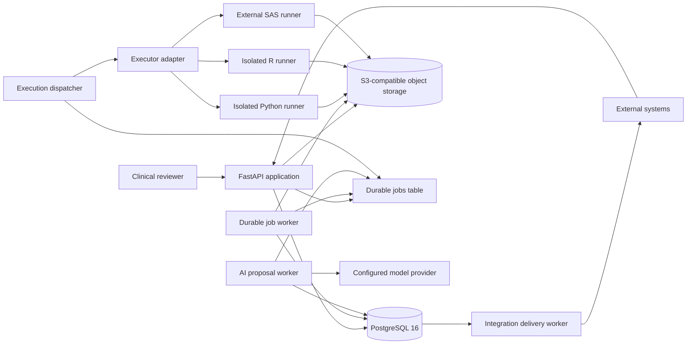
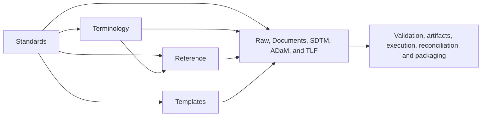

# Clinical Artifact Platform Architecture

## 1. Purpose and scope

The Aurinara Clinical Platform is a standalone, AI-first system for data management and statistical programming. It manages raw data and generates, validates, reviews, executes, and packages clinical study deliverables across Raw, Documents, SDTM, ADaM, and TLF workflows. The Documents module contains Protocol, SAP, and study operational and quality deliverables.

Release 1 provides typed AI proposal generation, human review gates, versioned standards/terminology/template registries, study reference data, immutable reconciliation, deterministic artifact generation from accepted revisions, traceability, standards validation, isolated Python and R execution, SAS program generation, and immutable submission packaging. AI proposals are untrusted drafts until an authorized human accepts them. The platform records assumptions and unresolved items rather than presenting uncalibrated confidence scores, and it does not claim regulatory certification or parity with commercial validators.

### Central Repository boundary

The separately deployed Aurinara Platform owns Repository folders, logical files,
versions, access envelopes, and stored bytes. This application continues to own
clinical artifact and source-file meaning. Local rows reference exact Platform
object/reference IDs in connected deployments and exact application-owned object
keys in standalone deployments. A row carries exactly one storage locator. Disabled
mode reads only application-owned bytes; enforced mode reads only Platform-owned
bytes. Missing or mode-incompatible locators fail with a typed error and never fall
back to the other provider.

The native Repository explorer uses one predictable taxonomy for published files:
`Study / Module / Solution / Purpose / File`. Module is the owning clinical area
(for example Raw, Documents, SDTM, ADaM, or TLF), Solution is the exact owning
workbench or other aggregate (identified by a stable ID and displayed by code/name), and Purpose is the
file's role (for example Source Files, Specifications, Programs, Datasets, or
Reports). These structural folders organize entries only; they do not broaden the
entry's authorization envelope or change the originating domain record.

The system has no compatibility layer for an existing backend and no legacy migration requirement.

## 2. Architectural principles

1. **Dual authoring, human authority.** AI proposal generation is the recommended default, and authorized users may also create or edit typed content manually from scratch. AI output still requires explicit accept/reject/revision review; manual writes pass the same module validation, optimistic concurrency, immutable-revision, lineage, and staleness rules and record the responsible human identity.
2. **Strict module ownership.** Each clinical module owns its API routes, domain model, repositories, services, validators, and builders.
3. **Explicit integration.** Modules collaborate through typed service interfaces and stable identifiers. A module must not import another module's repository or database implementation.
4. **Immutable evidence.** AI generation runs, proposals, review decisions, validation runs, generated artifacts, execution manifests, outputs, and packages are immutable snapshots.
5. **Deterministic builds.** Model generation is not assumed deterministic. Every proposal freezes its exact context and provider/model/instruction provenance; after human acceptance, builds remain deterministic and record a canonical dependency fingerprint, generator version, standards/terminology/schema/template/rule-pack versions, accepted proposal and content revisions, source-plan and IR/operator/compiler versions, and input artifact IDs.
6. **Safe execution.** Programs run in disposable, resource-limited containers with no external network access. SAS uses an external runner adapter.
7. **Standards transparency.** The platform reports exactly which standards, schemas, terminology releases, templates, rule packs, validators, input selections, Specifications, source plans, IR/operator versions, and compilers were used.
8. **Study isolation.** Every owned record is scoped to a study, and every service operation enforces study membership.
9. **Capability-based extensibility.** Shared services discover typed module capabilities from a startup registry instead of hard-coded module switches.
10. **Controlled interoperability.** External systems use versioned APIs or signed outbox-backed events and never bypass module services, study authorization, provenance, or validation.

## 3. System context



The API accepts commands and queries, performs synchronous content validation where practical, and creates durable jobs for AI proposals, builds, validation, reconciliation, execution, and packaging. Workers claim jobs from PostgreSQL. The API process never calls a model provider. Source files and generated bytes live in object storage; PostgreSQL contains their metadata, proposal provenance, review decisions, and traceability.

### AWS production topology

The production deployment is a single-region deployment in `us-east-1`. The
network spans two availability zones. The supported `standard` profile uses
redundant NAT and Multi-AZ PostgreSQL; the low-traffic `budget` profile uses one
NAT and a Single-AZ database while preserving the same private subnet boundary.
CloudFront is the only public application edge. It reads the React bundle from a
private S3 origin through origin access control and forwards uncached `/api/*`
and `/health/*` requests through a CloudFront VPC origin to an internal ALB. In
the budget profile, the Platform-owned ALB and WAF are shared by the three
product CloudFront distributions, with origin-only product headers selecting
the owning target group. The ALB targets the Fargate API service. Standard build,
execution, integration, and platform-projection workers are independent Fargate
services and share no public listener. Budget workers are EventBridge-scheduled,
drain-to-empty Fargate Spot tasks backed by the same durable queues.

PostgreSQL 16, artifact S3, execution EFS, Secrets Manager, KMS, and the platform
projection SQS queue are application-owned resources. Staging and production use
separate Platform-owned VPCs; Aurinara and EDC consume the matching environment's
private subnets while retaining separate security groups, keys, buckets,
databases, queues, and secrets. Product databases remain separate in both
profiles. Regional disaster recovery is deferred.
Standard backend platform calls traverse an interface endpoint to the external
`aurinara-platform` PrivateLink service. Budget calls use the shared internal
ALB URL inside the Platform VPC. Browser Repository calls use only the platform's
public authenticated edge.

The production executor adapter stages a UUID workspace on an EFS access point
that enforces UID/GID `10001`, starts a digest-pinned language runner as a
disposable Fargate task, and consumes a bounded result envelope from that
workspace. Runner tasks have no task role, public IP, or NAT route; use a
read-only root filesystem; drop all Linux capabilities; and can reach only EFS
and the AWS endpoints required for image pull and lifecycle logs. The Docker
adapter remains the local-development implementation. See
`docs/aws-deployment.md` for the deployment and operating contract.

### Shared Aurinara control plane

Deployment may connect this product to the independently deployed `aurinara-platform`
control plane. That service owns OIDC identity mappings, canonical study identity,
memberships, authorization policy, and an opaque shared-object catalog. This product keeps
its database, releases, workflow state, artifact provenance, and outbox. It consumes
versioned HTTP/OpenAPI contracts and idempotent events only; it never imports the control
plane ORM or reads its database.

Canonical study projections update the platform-owned code, name, and sponsor without changing
the product-owned study lifecycle. Authorization has two modes: `disabled` uses local study
membership and `enforced` uses the Platform decision with a maximum 60-second positive cache
and event-driven invalidation.
Objects retain product-owned artifact metadata while shared immutable bytes are addressed
only by opaque `platform_object_id`; storage keys and shared-bucket credentials are never
exposed through product APIs or browser code. See `docs/shared-platform-control-plane.md`.

## 4. Repository layout

```text
clinical-artifact-platform/
  src/
    app/
      main.py
      config.py
      api/
      common/
      kernel/
      integration/
      standards/
      terminology/
      reference/
      templates/
      assistance/
      review/
      reconciliation/
      raw/
      documents/
      sdtm/
      adam/
      tlf/
      transformation/
      artifacts/
      execution/
      validation/
      packaging/
  workers/
    job_worker.py
    assistance_worker.py
    execution_dispatcher.py
    integration_dispatcher.py
  runners/
    python/
    r/
    sas_adapter/
  migrations/
  schemas/
    usdm/
    define_xml/
  terminology/
    cdisc/
  templates/
    documents/
      protocol/
      sap/
      operations/
      quality/
    csdrg/
    adrg/
    validation/
  tests/
    unit/
    integration/
    contract/
    conformance/
    e2e/
  docs/
  docker-compose.yml
  Dockerfile.api
  Dockerfile.worker
  pyproject.toml
```

Each domain package uses a shallow feature-oriented shape where applicable:

```text
<module>/
  descriptor.py      # immutable ModuleDescriptor and capability registration
  routes.py          # route aggregator only
  *_routes.py        # feature-owned routes and transport translation
  models.py          # domain entities and value objects
  schemas.py         # Pydantic API contracts
  repository.py      # repository interfaces and SQLAlchemy implementation
  service.py         # registered capability facade
  *_service.py       # focused use cases and transaction boundaries
  validators.py      # clinical and structural validation
  builders.py        # artifact builders and render inputs
  capabilities.py    # typed adapters implemented for shared services
  events.py          # versioned domain-event contracts and outbox mapping
  interfaces.py      # services exposed to other modules
```

`common` contains technical primitives only: identifiers, clocks, database sessions, problem details, pagination, hashing, canonical JSON, and transactional helpers. Business concepts remain in the module that owns them.

The frontend mirrors clinical ownership under `frontend/src/features/{raw,documents,sdtm,adam,tlf}`. Route files compose feature panels and remain thin. A feature may import generated API modules and shared UI/workbench primitives, but ESLint forbids importing another clinical feature's internals. Generated OpenAPI and Orval output are clean-checkout build artifacts and are not tracked.

## 5. Technology baseline

| Concern            | Choice                                        | Rationale                                               |
| ------------------ | --------------------------------------------- | ------------------------------------------------------- |
| Runtime            | Python 3.13                                   | Supported language baseline for API and workers         |
| API                | FastAPI, Pydantic 2                           | Typed HTTP contracts and OpenAPI generation             |
| Persistence        | PostgreSQL 16, SQLAlchemy 2, Alembic          | Transactions, JSONB, locking, and migrations            |
| Object storage     | S3 in deployment, MinIO locally               | Durable source and artifact storage                     |
| Durable queue      | PostgreSQL jobs with `FOR UPDATE SKIP LOCKED` | Atomic state changes without a second queueing platform |
| Document rendering | `python-docx`, `reportlab`                    | DOCX and PDF output from a shared representation        |
| Workbooks          | `openpyxl`                                    | Specifications and reviewed bulk-import templates       |
| AI providers       | Typed HTTP adapters behind `assistance`       | Provider-neutral structured proposal generation         |
| XML                | `lxml`                                        | Define-XML rendering and local XSD validation           |
| XPT                | `pyreadstat`                                  | SAS transport v5 read/write support                     |
| Tabular data       | `pandas`, `pyarrow`                           | CSV and Parquet input/output                            |
| Execution          | Docker locally; disposable ECS tasks in AWS    | Equivalent isolation behind one typed executor boundary |
| Tests              | pytest, Hypothesis, Testcontainers            | Unit, property, and real-service integration testing    |

Dependency versions are explicit. Every SDTM Specification operation resolves the explicitly selected SDTMIG resource directly from CDISC Library, including catalog/domain discovery, read, initialization, direct save, import/replay, export, and Specification AI proposal generation or acceptance. Created revisions record the canonical href and live response checksum; proposal context contains a normalized typed extraction rather than the unrestricted provider response. Other CDISC standards metadata and controlled terminology are imported on demand and retained as immutable checksum-addressed object-store snapshots. Locally required conformance schemas and document templates remain pinned in source control. Their exact versions and checksums are recorded in artifact manifests.

## 6. Modular monolith boundaries

The application is deployed as one API and a small set of worker processes, while code and persistence ownership remain modular.

| Module         | Owns                                                                                                                          | May consume through interfaces                                                                                                                                                         |
| -------------- | ----------------------------------------------------------------------------------------------------------------------------- | -------------------------------------------------------------------------------------------------------------------------------------------------------------------------------------- |
| Kernel         | Typed module descriptors, capability protocols, startup registration and conflict validation                                  | Module-provided routers and typed capability implementations; no clinical repositories                                                                                                 |
| Integration    | External-system registrations, external identifiers, subscriptions, delivery attempts, signing metadata, connector interfaces | Module registry, outbox events, typed resource links, authentication, jobs                                                                                                             |
| Standards      | Standard products, versions, compatibility, selected provider snapshots, pinned asset provenance                             | CDISC Library connector, repository-pinned conformance schemas and exceptional assets                                                                                                  |
| Terminology    | Immutable terminology releases, codelists, terms, bindings, sponsor extensions                                                | Selected CDISC Library terminology snapshots, Standards, validation                                                                                                                    |
| Reference      | Study-scoped organizations, countries, sites, vendors, languages, units, roles, and milestones                                | Standards and Terminology code resolution, validation, trace links                                                                                                                     |
| Templates      | Template families, immutable versions, applicability, renderer compatibility                                                  | Repository templates, Standards compatibility metadata                                                                                                                                 |
| Assistance     | Provider adapters, instruction versions, immutable generation runs, proposal envelopes, usage and failure metadata            | Module-registered proposal handlers and exact context DTOs; no clinical repositories                                                                                                   |
| Review         | Human review items, comments, assignments, proposal decisions, dispositions, and status                                       | Typed entity and proposal resolvers, Templates for reports, validation, trace links                                                                                                    |
| Reconciliation | Immutable comparisons of exact revisions and artifacts                                                                        | Module context interfaces, Templates for reports, artifacts, validation                                                                                                                |
| Raw            | Raw dataset and variable metadata, immutable file bindings, previews, Raw artifacts                                           | Standards, Terminology, Reference, Templates, source files, artifacts, validation, trace links                                                                                         |
| Documents      | Protocol, USDM, evidence, SAP, operational documents, quality workbooks, and their artifacts                                  | Standards, Terminology, Reference, Templates, source files, read-only Raw context, artifacts, validation, trace links                                                                  |
| SDTM           | Exact Raw inputs, Specification, Domain/Variable Mappings, Code Workareas, Output Selection, aCRF, Define, cSDRG             | Standards, Terminology, Reference, Templates, read-only Raw context, isolated execution, artifacts, validation, trace links                                                          |
| ADaM           | Exact SDTM inputs, ADaM Specification, Derivation Plan, Define, ADRG                                                          | Standards, Terminology, Reference, Templates, Transformation compiler interfaces, read-only approved SDTM context and selected XPT artifacts, verified Documents trace endpoints       |
| TLF            | Shells, ADaM bindings, assumptions, ARS, ProgramPlan, result semantics, rendering, runs                                       | Standards, Terminology, Reference, Templates, Transformation compiler interfaces, read-only approved ADaM context and selected XPT artifacts                                           |
| Transformation | Internal typed Dataflow/Analysis IR, operators, canonicalization, lineage propagation, deterministic compiler interfaces      | Validated module-owned Derivation or Program plans; no direct repository access                                                                                                        |
| Artifacts      | Metadata, storage, fingerprints, staleness                                                                                    | Object store and ownership resolvers                                                                                                                                                   |
| Execution      | Manifests, runner dispatch, logs, outputs                                                                                     | Approved plans and artifact storage                                                                                                                                                    |
| Validation     | Immutable runs and common issue contract                                                                                      | Validator implementations registered by modules                                                                                                                                        |
| Packaging      | Package selection, reconciliation, ZIP manifests                                                                              | Explicit module service interfaces and artifact catalog                                                                                                                                |

Cross-module reads return immutable context DTOs. Mutations always pass through the owning module's service. Database foreign keys may enforce shared identity and ownership, but are not a license to query another module's tables directly.

### 6.1 Module extension kernel

Application composition creates a `ModuleRegistry` and registers one immutable `ModuleDescriptor` from every enabled module. Registration is explicit; filesystem scanning, import hooks, entry-point discovery, and runtime installation of arbitrary packages are not allowed. A descriptor contains:

```text
module_key              # stable lowercase one-word key; ^[a-z][a-z0-9]{1,31}$
module_version
api_prefix
content_schema_versions
dependency_purposes
entity_types
relationship_types
artifact_types
source_plan_types
proposal_types
event_types
authorization_scopes
capabilities
```

Capability protocols cover dependency selection and staleness-edge enumeration, AI proposal context/generation/acceptance, validation, artifact ownership/building, typed entity resolution, review targets, reconciliation inputs, immutable context export, trace relationships, package contribution, compilation, execution, and domain-event publication. The registry maps each declared key or owned type to exactly one typed handler. Startup fails before serving traffic when a descriptor duplicates a module key, route prefix, owned entity or relationship type, artifact type, source-plan type, proposal type, or event type; declares a capability without its handler; exposes a route outside its prefix; or references an unknown dependency purpose.

Shared services depend on capability protocols, not concrete clinical packages. Adding a module therefore requires its package and descriptor registration, Alembic migrations, capability implementations, router, schemas, and tests, but does not require editing dispatch `if` statements in Artifacts, Validation, Review, Reconciliation, Traceability, Packaging, or Integration. The registry does not weaken ownership: a resolver returns an immutable typed DTO, an artifact contributor returns a build request/manifest contract, and a package contributor returns trusted path rules and required selections. No capability exposes another module's repository or ORM model.

Module descriptors are code-reviewed deployment configuration, not mutable clinical records. `/api/v1/modules` exposes safe descriptor metadata for discovery, but internal class names, database tables, credentials, and implementation paths are never returned. Core modules register through the same contract used by a deployment-added module so extension behavior is continuously exercised.

### 6.2 Shared dependency model

Standards, Terminology, Reference, and Templates are provider modules. They publish typed, versioned records; they do not own a clinical module's choice of those records. Every Raw, Documents, SDTM, ADaM, and TLF aggregate—and every deployment-added module declaring the dependency-consumer capability—owns a versioned `DependencySelection` that binds exact provider records for named purposes.

```text
standards:
  - purpose
  - standard_version_id
terminology:
  - scope
  - terminology_release_id
  - terminology_extension_revision_ids
references:
  - purpose
  - reference_id
  - reference_revision_id
templates:
  - purpose
  - artifact_type (when the purpose renders a persisted artifact)
  - template_version_id
```

Purpose and scope values are finite enums defined by the consuming module. IDs are never replaced with `latest`, date-relative aliases, or server-selected defaults. A dependency update requires `If-Match`, validates the complete selection through provider service interfaces, creates a new aggregate revision, and emits staleness events in the same transaction. Validation, build, execution, reconciliation, and packaging freeze the resolved selection and compatibility results in their immutable input manifests.

A downstream module does not inherit or overwrite an upstream module's selection. It binds an exact immutable upstream context, records that context's dependency revision and fingerprint, and validates compatibility with its own selection. This permits different modules to use different explicitly compatible versions while preventing an SDTM, ADaM, or TLF change from silently rewriting its upstream context.

The provider dependency direction is intentionally acyclic:



- Standards owns structural and exchange specifications such as USDM, SDTM IG, ADaM IG, Define-XML, and ARS, plus pinned assets and compatibility metadata. It does not own controlled terms or presentation.
- Terminology owns immutable published code systems, codelists, and terms. A study extension is a revisioned overlay on one exact base release and codelist; it cannot alter or shadow a published term.
- Clinical modules own where terminology applies. Their bindings connect a module-owned field, variable, or value-level condition to a Terminology codelist or term from the aggregate's exact selection; they never copy a provider codelist into module persistence.
- Reference owns study-instance facts such as a sponsor, Site 101, a vendor, a study role assignment, or a milestone. Reference records may bind codes from Standards or Terminology but do not copy or redefine those code systems.
- Templates owns presentation and interchange layouts: styles, section order, blank table or sheet structures, placeholders, and renderer compatibility. A template never supplies clinical narrative, mappings, derivations, risk decisions, signals, actions, or conclusions.

Compatibility metadata stays with the provider that owns it: Standards records standard-to-standard and asset compatibility; Terminology records the Standards purposes and versions to which a release applies; Templates records module, use, artifact type, content-schema, and renderer compatibility; Reference validates any coded fields through exact Standards or Terminology resolvers. The consuming module combines these typed results and owns the final accept/reject decision for its complete selection.

Publishing a new immutable standard, terminology release, or template version does not change or stale existing selections. Selecting another version does. Correcting Reference data or a terminology extension creates a new immutable revision, marks consumers of the superseded logical record as `dependency_refresh_required`, and stales their dependent validation runs and artifacts without rebinding or rewriting clinical content. New evidence-producing operations remain blocked until a user selects the new revision or explicitly reaffirms a still-permitted historical revision with a reason. Withdrawing or quarantining a selected provider version blocks new validation and builds according to typed compatibility policy while preserving historical artifacts and manifests.

### 6.3 Module use of shared dependencies

| Consumer                  | Standards                                                                                 | Terminology                                                                                   | Reference                                                                                                      | Templates                                                                                     |
| ------------------------- | ----------------------------------------------------------------------------------------- | --------------------------------------------------------------------------------------------- | -------------------------------------------------------------------------------------------------------------- | --------------------------------------------------------------------------------------------- |
| Raw                       | Optional raw-layout or metadata profiles; never an inferred SDTM standard                 | Raw value-list bindings and unit/code validation when explicitly configured                   | Source system, vendor, site, country, language, and unit context                                               | Data-dictionary and import/export workbook layout only                                        |
| Documents                 | USDM/content-schema versions and any explicitly applicable document standard              | Controlled statuses, categories, units, and document-specific code lists                      | Sponsor, vendors, sites, owners, roles, milestones, countries, languages, and display units                    | Exact PDF, DOCX, or XLSX layout per document artifact type                                    |
| SDTM                      | SDTM IG, Define-XML, and other selected exchange/schema versions                          | Exact SDTM terminology release plus study extension revisions                                 | Study/sponsor/site/country/language/unit facts selected for metadata or mappings                               | aCRF, cSDRG, specifications, and report presentation                                          |
| ADaM                      | ADaM IG and Define-XML versions compatible with the selected SDTM context                 | Exact ADaM terminology releases and extensions                                                | Study, sponsor, role, and unit facts used by metadata; analysis populations remain ADaM-owned clinical content | ADRG, specifications, derivation reports, and validation-report presentation                  |
| TLF                       | ARS or other explicitly selected analysis-results specification                           | Statistic, parameter, population, and display-code bindings proposed against the exact release and accepted by a human | Study labels, units, roles, and approved organization facts; AI drafts titles and interpretations for human acceptance | Shell and rendered table, listing, and figure presentation; templates do not define analyses  |
| Validation                | Uses the owning aggregate's frozen selection to choose compatible validator/rule versions | Validates identifiers and values against exact releases and extension revisions               | Checks resolved revision, type, study ownership, and effective status                                          | Uses a selected report template only after the immutable findings snapshot is complete        |
| Review and Reconciliation | Display and compare the exact selections of their targets or inputs                       | Never recode values while reviewing or comparing                                              | Resolve exact revisions for labels and comparison evidence                                                     | Use exact review/reconciliation report templates                                              |
| Artifacts and Execution   | Record or stage only versions supplied by the owner manifest                              | Never resolve a newer release at worker runtime                                               | Stage only explicitly declared revisions; do not query current values                                          | Load the exact version and verify its checksum and renderer compatibility                     |
| Packaging                 | Verify cross-artifact compatibility; never choose or upgrade a standard                   | Verify manifests use permitted exact releases and extension revisions                         | Include selected snapshots only and verify study ownership                                                     | Verify rendered artifacts and optional support manifests; never re-render during ZIP assembly |

Source files and trace links do not own dependency selections. A trace link preserves typed entity identity; the immutable validation, reconciliation, or artifact manifest supplies the dependency context under which the link was evaluated.

Validation, Review, Reconciliation, Artifacts, Execution, and Packaging do not maintain an independent clinical dependency selection. They consume the frozen selections of their exact owners or inputs. When one of these services renders its own report and no clinical owner selection covers that report type, the operation request supplies an exact report `template_version_id`, which is frozen in the operation and artifact manifests.

### 6.4 External integration boundary

Inbound integrations call the same `/api/v1` resources as interactive clients using service identities with explicit study membership and module scopes. File transfer uses immutable source-file upload/download resources; structured bulk transfer uses versioned module-owned JSON or XLSX imports. An integration-specific connector may translate an external payload into a module command, but the owning application service performs authorization, validation, concurrency checks, transaction handling, provenance, and event creation. There is no generic endpoint that writes arbitrary JSON into a clinical aggregate.

`external_identifiers` bind a stable external system/type/identifier tuple to one verified typed platform subject. Bindings are study-scoped, unique, optimistic-concurrency controlled, and resolved through the owning module's entity capability. They aid synchronization but never replace platform UUIDs or natural-key constraints.

Outbound integrations subscribe to registered public event types. A module declaring outbound events supplies a typed public-event projector and versioned JSON schema; the dispatcher never serializes an internal outbox payload directly. A committed outbox record is projected and validated into this envelope before delivery:

```text
id
type
schema_version
occurred_at
study_id
module_key
subject_type
subject_id
subject_revision
correlation_id
data                  # minimal event-specific contract
```

Events contain identifiers, lifecycle changes, checksums, status summaries, and API resource links only when declared by the event schema. Projection has a strict byte limit and fails closed when its schema or subject resolution is invalid. Full clinical payloads, dataset rows, credentials, signed download URLs, object-store keys, and runner details are prohibited. Subscribers retrieve permitted representations through the API, preserving authorization and current media negotiation.

Delivery is at least once. Each attempt records the event ID, subscription revision, destination fingerprint, attempt number, timestamps, response status, bounded response excerpt, and typed failure. Requests carry a timestamp, event ID, content digest, and HMAC signature. Consumers deduplicate by event ID. The dispatcher uses bounded exponential backoff, terminal dead-letter state, and operator-requested redelivery without changing the original event. Callback validation requires HTTPS outside local development, rejects embedded credentials and unsafe redirects, resolves and rechecks destinations against private/link-local/metadata address policy, bounds response size/time, and never logs secrets or authorization headers.

Connector adapters are typed and deployment-configured. They may run in the integration worker or as separately deployed clients, but they cannot run inside execution containers or load untrusted code into the API process. API versions, import schema versions, and event schema versions evolve independently; breaking changes require a new version while additive changes remain backward compatible.

### 6.5 AI proposal and human-review boundary

AI is the default drafting path anywhere Aurinara creates or changes clinical content, metadata meaning, mappings, derivations, narratives, annotations, executable programs, analyses, reference values, sponsor terminology extensions, or package selections. Exact provider imports, physical-schema extraction, checksum calculation, dependency resolution, validation, compilation, rendering, execution, and packaging verification remain deterministic services rather than model tasks.

This policy covers every authoring or decision surface rather than only SDTM:

| Area | AI proposes | Human or deterministic authority |
| --- | --- | --- |
| Raw | semantic labels, roles, descriptions, terminology, source disposition, metadata corrections | source bytes and observed physical schema are deterministic; human accepts semantics |
| Documents | Protocol/USDM, SAP, operational and quality narratives/rows, risks, signals, actions, citations, trace links | human accepts clinical/quality content; deterministic validators enforce contracts |
| SDTM | Specification scope, Domain/Variable/VLM mappings, code, aCRF/Define metadata, repairs, cSDRG narrative | human accepts; isolated runner and standards validators remain authoritative |
| ADaM | Specification, parameters, methods, origins, trace links, per-dataset plans, Define/ADRG narrative | human accepts; typed lowering, compilation, and execution remain deterministic |
| TLF | Shell, bindings, assumptions, ARS, ProgramPlan, titles, footnotes, interpretations | human accepts; statistical procedure and rendering validation remain deterministic |
| Reference and terminology extensions | evidence-grounded facts, corrections, and extension terms | human accepts; exact provider releases are immutable and never AI-authored |
| Validation and reconciliation | issue explanations, grouping, and correction proposals | registered rules and exact comparisons determine findings; AI cannot change severity or pass state |
| Packaging | exact artifact selection and rationale | human accepts; package policy, reconciliation, path safety, and checksums are deterministic |
| Review | optional summaries or draft responses | acceptance, rejection, revision requests, dispositions, and rationale are human decisions |
| Standards, Templates, Integration, Kernel, Artifacts, Execution | selection explanations or operator guidance only | provider snapshots, layout assets, configuration, authorization, storage, and execution controls are deterministic/operator-managed |

`assistance` is a technical orchestration boundary. It owns configured provider adapters, immutable instruction versions, model-call limits, generation-run records, usage/failure metadata, and the shared proposal envelope. It never owns a clinical output schema, assembles a module prompt, queries a clinical repository, chooses a dependency, or applies a proposal. Each owning module registers stable proposal types and implements typed handlers for exact context assembly, output validation, diffing, acceptance, and resulting staleness.

The lifecycle is:

```text
queued -> running -> review_required -> accepted
                 |                   -> rejected
                 |                   -> revision_requested -> superseded
                 -> failed
```

Every generation run freezes the study, aggregate, proposal type/schema version, base aggregate and content revisions, dependency and input fingerprints, context checksum, provider and model identifiers, instruction/prompt version, bounded generation parameters, response checksum, token/usage metadata when supplied, validation issues, assumptions, unresolved items, creator, and timestamps. Provider credentials, unrestricted source rows, licensed payloads, object-store locations, and authorization tokens are never persisted in the proposal or prompt snapshot.

The model response is untrusted input. The module validates it through Pydantic and its ordinary domain, reference-resolution, traceability, security, and standards rules before a proposal can enter `review_required`. Invalid output remains immutable failed evidence and cannot be applied. The UI presents the exact base-to-proposal diff, evidence references, issues, assumptions, unresolved items, model limitations, and prior reviewer feedback; it does not convert a model's self-reported probability into an approval signal.

Only an authorized human can accept, reject, or request revision. Acceptance requires the current aggregate `ETag` and an idempotency key. The module re-resolves the exact base, revalidates the proposal, then commits the proposal decision, normal immutable module revisions, trace links, staleness changes, and outbox events once. A changed base returns `409 proposal_base_stale`; it is never silently rebased. Rejection and revision requests preserve active content unchanged. A revision request creates a new generation run bound to the prior proposal and immutable reviewer guidance.

Model-provider network access is owned by Aurinara Platform. Aurinara's API reads the product-scoped agent catalog with its Cognito service identity and freezes the selected agent ID, catalog revision, provider, and model in the generation run. Only the assistance worker sends the module-owned typed request to Platform's versioned one-shot invocation endpoint. Platform resolves and invokes its registered AgentCore Runtime, forwards the same service token to the Runtime authorizer, bounds and validates the response, and rejects model or revision drift. Aurinara stores the returned checksum and provenance, validates the clinical payload, and never receives Runtime coordinates or direct AgentCore IAM permission. Model-generated Python, R, or SAS remains inert proposal data until human acceptance and executes only through the network-disabled runner boundary.

## 7. Persistence model

All primary identifiers are UUIDs. Human-facing codes such as `DM`, `ADSL`, and `T-14-1` are separate natural keys with uniqueness rules scoped to their owning aggregate.

Relational columns store identity, study ownership, lifecycle status, stable references, timestamps, and commonly searched attributes. JSONB stores versioned, standards-heavy structures that would otherwise create brittle table designs. JSONB payloads have Pydantic contracts and explicit schema versions; they are never untyped dumping grounds.

### 7.1 Shared tables

```text
studies
source_files
trace_links
validation_runs
validation_issues
artifact_builds
artifacts
execution_runs
execution_outputs
submission_packages
ai_instruction_versions
ai_generation_runs
authoring_proposals
proposal_review_decisions
jobs
outbox_events
integrations
external_identifiers
integration_secret_versions
integration_subscriptions
integration_delivery_attempts
```

`source_files` is the shared technical record for immutable uploaded bytes. A clinical module may reference a source file through its service interface, but the file record does not contain module-specific semantics.

`ai_generation_runs` and `authoring_proposals` store the shared immutable envelope and fingerprints; proposal payloads validate against a registered module-owned schema. `proposal_review_decisions` are append-only human evidence. Accepted module revisions retain the originating proposal and decision IDs so artifacts and packages can trace clinical content back to both model generation and human authority without moving the content into `assistance` or `review`.

`integrations`, `external_identifiers`, and subscriptions are study-scoped. External tuples are unique per integration and target verified registered entity types. Subscription edits create a new revision; delivery attempts pin that revision and the immutable outbox event ID. Delivery attempts are append-only except for bounded lease/terminal-state transitions. Signing secrets use separate encrypted, versioned records with non-secret fingerprints and are never recoverable through read APIs.

### 7.2 Module aggregate tables

```text
raw_workbenches
raw_datasets
raw_variables

standard_products
standard_versions
standard_assets
standard_version_compatibilities

terminology_releases
terminology_codelists
terminology_terms
terminology_release_compatibilities
terminology_extensions
terminology_extension_revisions
terminology_extension_terms

reference_records
reference_record_revisions

template_families
template_versions
template_version_compatibilities

raw_dependency_selections
document_dependency_selections
sdtm_dependency_selections
adam_dependency_selections
tlf_dependency_selections

review_items
review_comments

reconciliation_runs
reconciliation_inputs
reconciliation_results

validation_rule_packs
validation_rules

documents
document_contents
protocol_usdm_documents
protocol_evidence

sdtm_workbenches
sdtm_input_selections
sdtm_specifications
sdtm_domains
sdtm_variables
sdtm_terminology_bindings
sdtm_domain_mapping_revisions
sdtm_variable_mapping_revisions
sdtm_code_workareas
sdtm_code_revisions
sdtm_output_selections
sdtm_define_documents
sdtm_csdrg_documents

adam_workbenches
adam_input_selections
adam_specifications
adam_datasets
adam_variables
adam_parameters
adam_value_level_metadata
adam_methods
adam_terminology_bindings
adam_derivation_plans
adam_define_documents
adam_adrg_documents

tlf_workbenches
tlf_shells
tlf_bindings
tlf_assumptions
tlf_ars_documents
tlf_program_plans
tlf_runs
```

A deployment-added module owns module-key-prefixed aggregate tables and contributes reviewed Alembic revisions to the single ordered migration history. It may reference shared identities through foreign keys and typed interfaces but cannot add foreign keys directly into another clinical module's private tables or create schemas dynamically at startup.

The Raw module binds each raw dataset record to an exact immutable `source_file` and stores dataset and variable metadata separately from the uploaded bytes. Replacing a dataset file creates a new source file and updates the binding through an optimistic-concurrency-controlled command; it never overwrites the prior object. Physical schema inspection deterministically supplies observed names, types, lengths, and column order. AI proposes semantic labels, roles, terminology bindings, descriptions, source dispositions, and corrections for human review without altering the source bytes or claiming that inferred metadata was observed fact.

The Standards and Terminology registries expose immutable version records for exact provider snapshots; Templates exposes immutable versions of repository-pinned presentation assets. Validation, generation, execution, reconciliation, and packaging never download or silently upgrade provider content. Compatibility links state which standards, terminology releases, schemas, templates, validators, generators, modules, and artifact types may be used together. Provider services return typed resolution DTOs containing identity, version, checksum, lifecycle, applicability, and compatibility evidence.

Pinned provider-asset content bytes live in the same S3-compatible object store as generated artifacts, keyed by `checksum_object_key(sha256)` derived from each asset's registered `checksum`; the database `checksum` remains the integrity source of truth and no `object_key` column is required. The preferred CDISC administration command fetches one explicitly selected concrete release graph into an ephemeral workspace, canonicalizes and hashes every response, publishes the verified bytes to object storage, and only then opens the database transaction that registers the release. Temporary acquisition files are destroyed after the command. Content-addressed re-uploads of identical bytes are no-ops. Hand-maintained exceptional assets and templates retain their reviewed repository importers. The `publish-assets` command backfills object storage only for repository-backed rows; CDISC on-demand rows already require published objects. Snapshot content reads re-hash fetched bytes against the registered checksum; SDTM Specification live reads instead hash the provider response and persist that checksum on the revision. The development-only local fallback applies only to paths intentionally rooted under `schemas/`, `terminology/`, or `templates/` and is never used by live Specification reads. Production rejects local fallback. Per-request content unavailability surfaces as typed problem responses.

The Standards registry models CDISC products separately from exact releases. It supports model, implementation-guide, data-collection, data-exchange, analysis, therapeutic-area, measure, and foundational products without hard-coding a closed product list. An exact release may contain multiple checked assets and typed directional relationships to other releases. This represents, for example, an implementation guide's exact model dependency instead of flattening SDTM and SDTMIG into one version string. The Terminology registry preserves complete CDISC/NCI publication semantics: terminology product, publication date, NCI concept IDs, codelist submission values, definitions, preferred terms, synonyms, extensibility, term status, and exact compatibility with standard releases. Sponsor overlays are allowed only for extensible codelists.

CDISC Library is the upstream authority for standards metadata and controlled terminology. The SDTM Specification workflow is the deliberate live-read exception: its server-side routes call the selected canonical SDTMIG `/mdr/` href with the environment-backed API key and record the exact response checksum. No credential is returned to the browser. Other consumers use administrator-imported immutable selections: the importer follows only the selected root and descendants, rejects catalogs and mutable `/mdr/root/` aliases, bounds response and graph size, and records acquisition provenance and checksums. Existing non-Specification work remains bound to imported immutable releases.

Reference records are study facts with typed `reference_type` contracts. AI may draft a fact or sponsor-terminology extension only from cited study evidence and exact selected terminology; a human acceptance creates the immutable revision under a stable logical identity. Retiring an identity prevents new bindings but preserves historical resolution. Review records contain human workflow state and typed links but are not electronic signatures or a formal regulatory audit trail. Reconciliation runs are immutable snapshots of exact inputs, comparison version, results, issues, and generated report artifacts.

The Documents module uses a `document_type` discriminator and versioned Pydantic content and proposal contracts. Protocol and Statistical Analysis Plan retain specialized schemas, evidence-grounding policies, and validators inside the module. AI drafts new documents and revisions from exact cited source evidence; humans review field-level changes and accept, reject, or request revision. The remaining operational documents and quality workbooks use type-specific content models; they are not arbitrary JSON documents. PDF outputs use the shared renderer-neutral `Document` model, and XLSX outputs use typed row models rendered with `openpyxl`.

The SDTM workbench has an exact immutable Raw input selection, one versioned Specification covering all domains, manually authored or AI-proposed Domain and Variable Mappings, multiple named Code Workareas, and one exact revisioned Output Selection. The Specification owns reusable typed value contexts; value-level metadata references those contexts. Domain Mapping declares the Raw datasets and logical upstream SDTM domains used by a generated domain. Variable Mapping is sparse declared lineage from a target variable and optional value context to an ordered list of qualified source variables. Neither mapping is executable and empty cells are valid. AI-drafted Python, R, or SAS becomes executable authority only after human acceptance; manually authored source uses the same immutable revision and isolated execution boundary.

Each Code Workarea fixes its domain and language while immutable source revisions pin the current Specification and mapping heads. Tests run full exact inputs without publishing outputs. Generation snapshots the source, executes through the isolated runner, validates an exact own-domain CSV against the Specification, performs XPT v5 write/read-back, and atomically publishes the program, CSV, XPT, log, and validation evidence. Imported XPT domains remain an alternate provider and need no mappings or workarea. Output Selection chooses exactly one successful generation or aligned import per Specification domain and verifies that downstream generations consumed the same selected upstream XPT artifacts. Aggregate validation, Define, cSDRG, ADaM context export, and packaging consume this exact set and never resolve “latest.”

An SDTM input selection records the Raw workbench and revision, successful validation run, exact source-file artifact IDs and checksums, and the upstream dependency fingerprint. Changing the selection creates a new SDTM revision and stales every dependent preview, validation run, program, execution, dataset, aCRF reconciliation, Define document, cSDRG, downstream ADaM/TLF context, and package. SDTM never queries Raw repositories directly or substitutes a newer source artifact.

The ADaM workbench is an analysis-metadata aggregate, not an SDTM workbench with renamed resources. Its dual authoring surface follows the same three-part pattern: an exact immutable SDTM input selection, one versioned ADaM Specification covering all datasets, and one versioned Derivation Plan per dataset (each keyed by `(aggregate, dataset, revision)` and producing only its own dataset). Users may author these typed contracts manually or ask AI to draft them from exact approved Protocol/SAP and SDTM context; AI drafts require human acceptance before they become active revisions. The ADaM Specification contains dataset class and key metadata, variables, parameters, value-level metadata, controlled-terminology usage, origins, and reviewer-readable methods. Each per-dataset Derivation Plan contains executable typed dataflow semantics, reads predecessor datasets through an `adam_read` node resolved against the Specification with server-resolved upstream plan pins, and links its outputs back to the Specification. The union of per-dataset plans must cover every derived dataset. Methods explain derivations for reviewers but are never executable. Relationships from Protocol or SAP objectives, endpoints, estimands, populations, or methods to ADaM datasets, variables, parameter values, or value-level metadata are normalized trace links, not a second ADaM-owned relationship store.

An ADaM input selection records the SDTM workbench and revision, successful validation run, exact XPT artifact IDs and checksums, and the upstream dependency fingerprint. Changing the selection creates a new ADaM revision and stales every dependent preview, validation run, program, execution, dataset, Define document, ADRG, and TLF context. ADaM never queries SDTM repositories directly or substitutes a newer SDTM artifact.

ADaM retains its Specification and per-dataset Derivation Plan lifecycle and internal Dataflow IR lowering. SDTM intentionally uses a different mapping-and-code lifecycle: mappings carry declared lineage, while immutable code revisions and exact run inputs carry executable provenance. One TLF workbench owns a study-wide output inventory and per-output Shells, Bindings, Assumptions, ARS, and ProgramPlans. Each stage supports typed manual creation/editing and an ordered AI proposal path over the same exact selected evidence. All clinical modules retain module-owned schemas, optimistic concurrency, immutable revisions, explicit input selection, and staleness behavior; they do not share a public universal clinical plan.

### 7.3 Transactions and events

Each command uses one database transaction. State changes and their `outbox_events` row commit together. Internal consumers use events for staleness propagation and long-running work. The integration dispatcher reads only committed outbox events, creates idempotent delivery attempts for matching subscription revisions, and performs network delivery outside the originating transaction. Consumers and delivery scheduling are idempotent by event ID.

Bulk XLSX and JSON imports parse and validate the entire payload before opening the commit transaction. An error returns a problem response with all actionable issues and leaves the aggregate unchanged.

### 7.4 Jobs

`jobs` is the durable queue for AI generation, builds, executions, large validation runs, reconciliation runs, and packaging. A worker claims only its configured job types in a short transaction using `SELECT ... FOR UPDATE SKIP LOCKED`, sets a lease owner and expiry, and commits before doing work. The assistance worker is the only clinical worker with model-provider egress. Leases allow recovery after worker failure. Terminal transitions are idempotent, and cancellation is cooperative.

Suggested lifecycle:

```text
queued -> running -> succeeded
                 -> failed
                 -> cancelled
queued ----------------> cancelled
```

## 8. Traceability

Trace links use a normalized polymorphic edge table:

```text
id
study_id
source_module
source_type
source_id
target_module
target_type
target_id
relationship
metadata JSONB
created_at
```

The traceability service maintains a registry of endpoint resolvers. Before inserting a link it verifies that both endpoints exist, belong to the same study, support the requested relationship, and are visible to the caller. Unique constraints prevent duplicate edges.

The Raw module owns resolvers for raw datasets and raw variables. SDTM and aCRF services create relationships to those endpoints only through the traceability service; they do not read Raw persistence directly.

The Documents module owns resolvers for Protocol objectives and endpoints, SAP estimands and methods, deviations, risks, signals, actions, observations, and CAPA records. Relationships within the combined module and from downstream modules still pass through the traceability service so study ownership and supported relationship types are verified consistently.

Required end-to-end chains include:

```text
Protocol objective
  -> Protocol endpoint
  -> SAP estimand or method
  -> ADaM dataset or variable
  -> TLF output

CRF annotation
  -> Raw variable
  -> SDTM variable
  -> SDTM Variable Mapping cell
  -> ADaM Derivation Plan node and derived variable
```

aCRF evidence links to exact SDTM variable rows and may independently link to Raw variables. It does not target SDTM graph nodes. ADaM plan-node endpoints continue to resolve inside the owning per-dataset plan.

Trace reports find gaps, dangling references, and links to superseded inputs. Links are evidence of declared relationships; validation decides whether a required chain is complete.

## 9. Validation architecture

Module validators emit a common issue contract:

```text
id
code
severity: error | warning | info
message
suggestion
module
entity_type
entity_id
field_path
dataset
variable
artifact_id
```

A validation run is an immutable snapshot containing validator name/version, canonical input fingerprint, start and completion timestamps, issue counts, complete issues, and report artifact IDs. Revalidation creates a new run.

The validation service also owns a declarative rule registry. A rule records a stable ID, version, owning module, applicability expression, typed parameters, default severity, implementation identifier, and test-fixture version. Rule packs select exact rule versions. Sponsor-defined packs may configure and combine registered rules but cannot contain executable code or bypass module validators.

Errors block dependent generation, execution, or packaging. Warnings remain visible in reports and package manifests. The latest successful run is convenient status, but downstream operations bind to the exact validation run and fingerprint they evaluated.

Validator categories are:

- contract and schema validation;
- module business rules;
- standards conformance checks;
- cross-record referential checks;
- artifact reconciliation;
- cross-module traceability and package checks.

Reconciliation is distinct from ordinary validation: it compares two or more exact revisions or artifacts and records each input ID and checksum. Reconciliation findings use the common issue contract but remain identifiable as reconciliation results.

## 10. Artifact lifecycle and staleness

Generated bytes are immutable and stored under checksum-addressed object keys. Regeneration always creates a new artifact record. Each artifact records the owning aggregate's dependency-selection revision and a dependency fingerprint over resolved Standard assets, Terminology releases and extension revisions, Reference revisions, Template assets, lifecycle states, and compatibility evidence. The full input fingerprint also includes canonical clinical inputs, input-selection revision, Specification revision/fingerprint when applicable, selected upstream artifact IDs and checksums, relevant configuration, rule-pack versions, module-owned source-plan revision, internal IR/operator/compiler versions when applicable, and generator name/version.

When an upstream clinical record or selected mutable dependency is superseded, the outbox event identifies potentially dependent artifacts. The artifact service recomputes or invalidates their current-dependency comparison. Publishing an unrelated or newer immutable registry version emits no staleness event for pinned consumers. A stale artifact remains downloadable and auditable but cannot be selected for a new package.

For a deployment-added module, the staleness service obtains upstream edges and affected owner/artifact identities through that module's registered staleness capability. It does not inspect the module's tables or require a central module-name branch. Edge enumeration is deterministic and study-scoped; missing or invalid targets fail validation rather than being ignored.

Lifecycle states should distinguish build progress from usability, for example:

```text
pending -> building -> available
                    -> failed
available + dependency mismatch = stale
```

The full catalog and artifact-specific prerequisites are defined in [artifact-catalog.md](artifact-catalog.md).

## 11. Shared document rendering

Documents narrative PDF and DOCX outputs, cSDRG, ADRG, validation reports, review reports, and reconciliation reports use a renderer-neutral representation:

```text
Document
  metadata
  cover
  sections[]
    heading
    paragraphs[]
    tables[]
    lists[]
    citations[]
  appendices[]
  headers
  footers
```

Module builders create this structure solely from saved records. Templates define presentation and section order. DOCX and PDF renderers consume the same structure, and conformance tests compare normalized content so the formats remain equivalent.

Builders resolve an exact immutable template version through the Templates service. Template records declare supported document or workbook types, renderer version ranges, required content schema versions, asset checksum, provenance, and lifecycle status. A template update creates a new version and never changes prior artifact provenance.

Uploaded original PDFs and annotated evidence overlays are not narrative renderings; they retain source/evidence-specific builders while following the same immutability, checksum, provenance, and validation rules.

Documents XLSX builders consume type-specific, versioned workbook models with declared sheets, columns, row identifiers, controlled values, and cross-row references. They use `openpyxl`, preserve input ordering where required, and never derive risk ratings, deviations, signals, actions, observations, or CAPA decisions that users did not persist.

## 12. Transformation, compilation, and execution

### 12.1 Framework decision

SDTM, ADaM, and TLF share the compiler framework below their public domain models. They do not share a public plan resource, persistence table, or universal clinical node catalog.

| Module-owned authoring contract      | Internal lowering target                               | Deliberately not shared                                                                   |
| ------------------------------------ | ------------------------------------------------------ | ----------------------------------------------------------------------------------------- |
| SDTM Specification + mappings + Code Workarea | Direct isolated program execution; no SDTM IR lowering | Domain mappings and variable mappings are declared lineage; authored source is executable |
| ADaM Specification + Derivation Plan | Dataflow IR                                            | Dataset classes, parameters, value-level metadata, origins, methods, and ADaM conformance |
| TLF ARS + ProgramPlan                | Analysis IR; data-preparation portions use Dataflow IR | Analysis intent, shell coverage, result semantics, and output interpretation              |
| TLF shell + Template                 | Renderer input, not compiler IR                        | Titles, footnotes, layout, pagination, and visual styling                                 |

This is one compilation framework, not one authoring framework. Clinical users work with the terminology of their module, while compiler and runner behavior is reused behind those contracts.

### 12.2 Domain authoring contracts

SDTM exposes one Specification plus per-domain Domain Mapping, Variable Mapping, and multiple Code Workareas. ADaM continues to expose one Specification plus one Derivation Plan DAG per dataset. TLF ProgramPlan remains a structured sequence of declared analysis steps and result requirements. These contracts are module-owned and do not expose a public polymorphic transformation resource.

SDTM code is accepted only in a named language-specific Code Workarea and runs only through the isolated runner. It is never evaluated by API preview logic or lowered to Dataflow IR. ADaM and TLF retain their typed-expression and explicit custom-function rules. SDTM validation covers exact mapping references, code/run pins, output schema and conformance, and coherent all-domain selection; it does not infer lineage from program source.

### 12.3 Internal IR and lowering

The Transformation package exposes internal typed DTO interfaces for Dataflow IR and Analysis IR. Dataflow IR covers reads, selections, filters, joins, unions, casts, projections, typed derivations, reshaping, terminology mappings, grouping, aggregation, windows, sequencing, sorting, assertions, and writes. Analysis IR adds explicitly named statistical procedures, estimators, options, grouping, and normalized result schemas; it can reference Dataflow IR units for preparation and post-processing.

ADaM and TLF own adapters from fully validated, revision-aligned immutable authoring models to IR. SDTM has no lowering adapter. The Transformation package never imports a clinical repository, validates clinical conformance, or invents missing steps. IR is not directly editable through the public API and is frozen inside compiler manifests for reproducibility and diagnosis where it applies.

For ADaM and TLF, the compiler fingerprint covers the exact module Specification revision, Derivation/Program Plan revision, input-selection revision, input artifacts and checksums, dependency fingerprint, normalized IR, operator and statistical-procedure versions, compiler version, and output declarations. SDTM run fingerprints instead cover the exact Specification and mapping revisions, immutable code revision, input selection, selected upstream XPT artifacts and checksums, dependency fingerprint, runner settings, and output declaration.

### 12.4 Compilation and execution

Compilation accepts only a module-validated, revision-aligned immutable authoring model, lowers its plan to normalized IR, applies semantics-preserving canonicalization, and creates deterministic Python, R, or SAS source plus a compiler manifest. For a custom function, a supplied body makes that language's artifact executable. A missing body produces a deterministic TODO stub and `compiler.executable=false` with the missing IDs in `compiler.todo_functions`; it does not block artifacts for languages whose bodies are present. Execution rejects a TODO artifact with `execution_custom_function_incomplete`. Cross-language conformance applies only where equivalent implementations were supplied and compares normalized outputs for the same authoring model. Structural values, identifiers, categories, and declared ordering compare exactly; floating-point statistical results use procedure-declared numeric tolerances and rounding occurs only at an explicit computation or presentation boundary. Statistical procedures record algorithm, options, and required library versions. A backend that cannot provide non-custom declared semantics returns `backend_capability_missing` before program publication rather than silently using a substitute method.

Execution follows this sequence:

1. Validate the owner metadata and plan, then bind the exact successful validation run.
2. Freeze the input selection, Specification when applicable, module-owned source plan, exact input artifacts, normalized IR, operator/procedure versions, and output declarations.
3. Compile deterministic programs and publish the program plus compiler manifest as immutable artifacts.
4. Create an immutable execution manifest.
5. Stage immutable input artifacts in a temporary workspace.
6. Start the language-specific container or external adapter.
7. Disable external network access.
8. Apply CPU, memory, wall-time, process, and output-size limits.
9. Capture stdout, stderr, exit code, timing, and resource metrics.
10. Validate output names, formats, schemas, checksums, assertions, and declared expectations.
11. Upload valid outputs and logs as immutable artifacts.
12. Destroy the temporary workspace.

Python and R images contain pinned runtime dependencies and run as non-root users with read-only base filesystems. Production dispatch uses an executor interface whose initial remote implementation targets AWS ECS tasks. The local implementation uses Docker.

SAS compilation produces source and a manifest. Until an external SAS adapter is configured, execution terminates with the typed status `runner_not_configured` and does not mark the plan or generated program invalid.

## 13. Define-XML and standards assets

SDTM and ADaM store version-neutral structured metadata for datasets, items, value-level items, codelists, methods, comments, origins, document references, leaf definitions, and applicable aCRF or SDTM references. Renderers translate that model into Define-XML 2.0 or 2.1.

Every rendered XML artifact is validated against a locally bundled, pinned XSD set. Dataset reconciliation verifies item identity, length/type metadata, value-level applicability, keys, codelists, origins, and leaf references against the exact selected XPT artifacts. Schema success is reported separately from platform conformance checks.

## 14. Security and operational boundaries

- The API validates externally issued JWTs for humans and service identities and derives subject, study membership, and registered module/action scopes from verified claims or an authorization service.
- Authorization in Release 1 is study membership plus registered module/action scopes and explicit service ownership checks; it is not field-level RBAC.
- Uploads are streamed, size-limited, content-sniffed, malware-scan-ready, and stored with generated object keys.
- User filenames are display metadata and never become object keys or package paths without sanitization.
- Database credentials, object-store credentials, JWT verification settings, executor credentials, integration signing secrets, and secret-encryption keys are injected as secrets. Integration signing material is encrypted at rest and plaintext is returned only once at creation or rotation.
- Logs are structured and include request, job, build, validation, reconciliation, execution, integration delivery, event, review-item, artifact, and study correlation IDs. Clinical payloads, dataset rows, review-comment bodies, tokens, signing secrets, authorization headers, and unbounded external responses are excluded.
- Outbound callbacks run only in the integration dispatcher with strict TLS, DNS/IP, redirect, port, timeout, request-size, and response-size policy. Execution containers retain network denial and cannot publish integrations directly.
- Health endpoints distinguish liveness from readiness; readiness checks PostgreSQL, object storage, and module-registry consistency without mutating them.
- Fine-grained RBAC, electronic signatures, and a formal regulated audit trail are deferred. Operational logs and immutable snapshots must not be represented as those capabilities.

## 15. Deployment topology

Release 1 consists of independently scalable containers built from the same repository:

- FastAPI API;
- durable job worker for builds, validation, reconciliation, and packaging;
- assistance worker for model-provider calls and typed proposal generation;
- execution dispatcher;
- PostgreSQL 16;
- S3-compatible storage;
- isolated Python and R runner images;
- optional external SAS adapter;
- integration dispatcher for signed outbound event delivery.

Local development uses Docker Compose and MinIO. Production uses managed PostgreSQL and S3-compatible storage, while the executor adapter launches isolated tasks. A separate integration dispatcher performs outbound network delivery so the API, clinical workers, and execution containers do not need general outbound access. API and worker deployments run migrations as an explicit release step rather than at process startup.

## 16. Deferred capabilities

The following are outside Release 1: legacy migration, microservices, runtime installation or hot loading of untrusted module/plugin code, fine-grained RBAC beyond module scopes and study membership, electronic signatures, formal audit trails, document comparison, autonomous acceptance of AI output, unreviewed automated mapping, commercial validator parity, regulatory gateway submission, and built-in SAS execution.

The product shell may also expose the shared Aurinara Platform Playground. Platform owns the common agent catalog, Runtime registration, durable conversation metadata, AgentCore invocation, Memory-backed history, and approve-once mutation prompts. Agents marked `clinical_proposal_v1` may also be selected through Aurinara's constrained proposal workflow. Aurinara still owns exact clinical context, typed validation, diffs, immutable proposal evidence, and human acceptance. Playground approval never substitutes for a proposal decision or bypasses module authorization, validation, ownership, or provenance.
