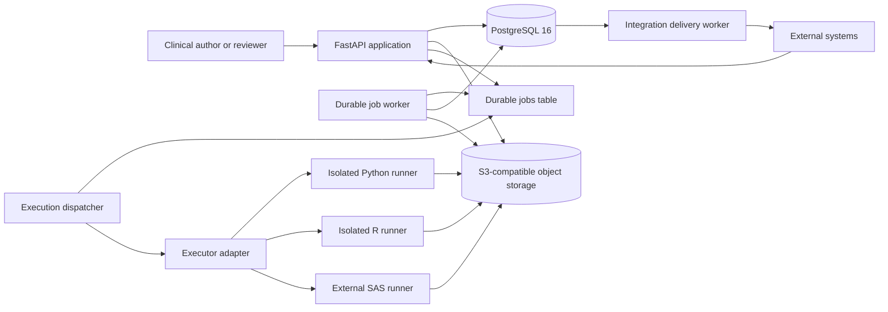
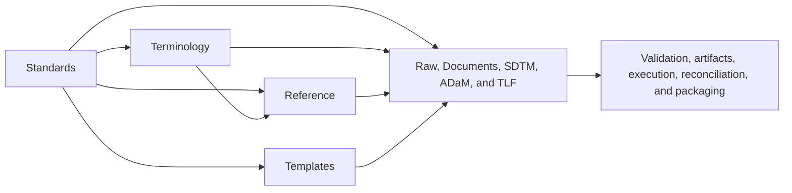

# Clinical Artifact Platform Architecture

## 1. Purpose and scope

The Aurinara Clinical Platform is a standalone system for data management and statistical programming. It manages raw data and authors, validates, generates, executes, and packages clinical study deliverables across Raw, Documents, SDTM, ADaM, and TLF workflows. The Documents module contains Protocol, SAP, and study operational and quality deliverables.

Release 1 provides structured authoring, versioned standards/terminology/template registries, study reference data, collaborative review, immutable reconciliation, deterministic artifact generation, traceability, standards validation, isolated Python and R execution, SAS program generation, and immutable submission packaging. The platform does not generate clinical content, mappings, proposals, or confidence scores. It validates user-authored content against pinned schemas and explicit business rules, but does not claim regulatory certification or parity with commercial validators.

The system has no compatibility layer for an existing backend and no legacy migration requirement.

## 2. Architectural principles

1. **Clinical decisions.** Users create and approve all clinical content, mappings, rules, assumptions, annotations, and review decisions.
2. **Strict module ownership.** Each clinical module owns its API routes, domain model, repositories, services, validators, and builders.
3. **Explicit integration.** Modules collaborate through typed service interfaces and stable identifiers. A module must not import another module's repository or database implementation.
4. **Immutable evidence.** Validation runs, generated artifacts, execution manifests, outputs, and packages are immutable snapshots.
5. **Deterministic builds.** A build records a canonical dependency fingerprint, generator version, standards/terminology/schema/template/rule-pack versions, input-selection and Specification revisions when applicable, source-plan and IR/operator/compiler versions, and input artifact IDs.
6. **Safe execution.** Programs run in disposable, resource-limited containers with no external network access. SAS uses an external runner adapter.
7. **Standards transparency.** The platform reports exactly which standards, schemas, terminology releases, templates, rule packs, validators, input selections, Specifications, source plans, IR/operator versions, and compilers were used.
8. **Study isolation.** Every owned record is scoped to a study, and every service operation enforces study membership.
9. **Capability-based extensibility.** Shared services discover typed module capabilities from a startup registry instead of hard-coded module switches.
10. **Controlled interoperability.** External systems use versioned APIs or signed outbox-backed events and never bypass module services, study authorization, provenance, or validation.

## 3. System context



The API accepts commands and queries, performs synchronous content validation where practical, and creates durable jobs for expensive builds, validation, reconciliation, execution, and packaging. Workers claim jobs from PostgreSQL. Source files and generated bytes live in object storage; PostgreSQL contains their metadata and traceability.

### Shared Aurinara control plane

Deployment may connect this product to the independently deployed `aurinara-platform`
control plane. That service owns OIDC identity mappings, canonical study identity,
memberships, authorization policy, and an opaque shared-object catalog. This product keeps
its database, releases, workflow state, artifact provenance, and outbox. It consumes
versioned HTTP/OpenAPI contracts and idempotent events only; it never imports the control
plane ORM or reads its database.

Canonical study projections update the platform-owned code, name, and sponsor without changing
the product-owned study lifecycle. Authorization is introduced through disabled, shadow, and
enforced modes with a maximum 60-second positive cache and event-driven invalidation.
Objects retain product-owned artifact metadata while shared immutable bytes are addressed
only by opaque `platform_object_id`; storage keys and shared-bucket credentials are never
exposed through product APIs or browser code. See `docs/shared-platform-control-plane.md`.

## 4. Repository layout

```text
clinical-artifact-platform/
  src/
    app/
      main.py
      config.py
      api/
      common/
      kernel/
      integration/
      standards/
      terminology/
      reference/
      templates/
      review/
      reconciliation/
      raw/
      documents/
      sdtm/
      adam/
      tlf/
      transformation/
      artifacts/
      execution/
      validation/
      packaging/
  workers/
    job_worker/
    execution_dispatcher/
    integration_dispatcher/
  runners/
    python/
    r/
    sas_adapter/
  migrations/
  schemas/
    usdm/
    define_xml/
  terminology/
    cdisc/
  templates/
    documents/
      protocol/
      sap/
      operations/
      quality/
    csdrg/
    adrg/
    validation/
  tests/
    unit/
    integration/
    contract/
    conformance/
    e2e/
  docs/
  docker-compose.yml
  Dockerfile.api
  Dockerfile.worker
  pyproject.toml
```

Each domain package follows the same internal shape where applicable:

```text
<module>/
  descriptor.py      # immutable ModuleDescriptor and capability registration
  api.py             # FastAPI routes and request/response translation
  models.py          # domain entities and value objects
  schemas.py         # Pydantic API contracts
  repository.py      # repository interfaces and SQLAlchemy implementation
  services.py        # use cases and transaction boundaries
  validators.py      # clinical and structural validation
  builders.py        # artifact builders and render inputs
  capabilities.py    # typed adapters implemented for shared services
  events.py          # versioned domain-event contracts and outbox mapping
  interfaces.py      # services exposed to other modules
```

`common` contains technical primitives only: identifiers, clocks, database sessions, problem details, pagination, hashing, canonical JSON, and transactional helpers. Business concepts remain in the module that owns them.

## 5. Technology baseline

| Concern            | Choice                                        | Rationale                                               |
| ------------------ | --------------------------------------------- | ------------------------------------------------------- |
| Runtime            | Python 3.13                                   | Supported language baseline for API and workers         |
| API                | FastAPI, Pydantic 2                           | Typed HTTP contracts and OpenAPI generation             |
| Persistence        | PostgreSQL 16, SQLAlchemy 2, Alembic          | Transactions, JSONB, locking, and migrations            |
| Object storage     | S3 in deployment, MinIO locally               | Durable source and artifact storage                     |
| Durable queue      | PostgreSQL jobs with `FOR UPDATE SKIP LOCKED` | Atomic state changes without a second queueing platform |
| Document rendering | `python-docx`, `reportlab`                    | DOCX and PDF output from a shared representation        |
| Workbooks          | `openpyxl`                                    | Specifications and manual bulk-import templates         |
| XML                | `lxml`                                        | Define-XML rendering and local XSD validation           |
| XPT                | `pyreadstat`                                  | SAS transport v5 read/write support                     |
| Tabular data       | `pandas`, `pyarrow`                           | CSV and Parquet input/output                            |
| Execution          | Docker containers behind an executor adapter  | Isolation and a path to AWS ECS tasks                   |
| Tests              | pytest, Hypothesis, Testcontainers            | Unit, property, and real-service integration testing    |

Dependency versions, standards schemas, controlled terminology, and document templates are pinned in source control. Their versions are recorded in artifact manifests.

## 6. Modular monolith boundaries

The application is deployed as one API and a small set of worker processes, while code and persistence ownership remain modular.

| Module         | Owns                                                                                                                          | May consume through interfaces                                                                                                                                                         |
| -------------- | ----------------------------------------------------------------------------------------------------------------------------- | -------------------------------------------------------------------------------------------------------------------------------------------------------------------------------------- |
| Kernel         | Typed module descriptors, capability protocols, startup registration and conflict validation                                  | Module-provided routers and typed capability implementations; no clinical repositories                                                                                                 |
| Integration    | External-system registrations, external identifiers, subscriptions, delivery attempts, signing metadata, connector interfaces | Module registry, outbox events, typed resource links, authentication, jobs                                                                                                             |
| Standards      | Standard products, versions, compatibility, pinned asset provenance                                                           | Repository-pinned schemas and assets                                                                                                                                                   |
| Terminology    | Immutable terminology releases, codelists, terms, bindings, sponsor extensions                                                | Pinned terminology assets, Standards, validation                                                                                                                                       |
| Reference      | Study-scoped organizations, countries, sites, vendors, languages, units, roles, and milestones                                | Standards and Terminology code resolution, validation, trace links                                                                                                                     |
| Templates      | Template families, immutable versions, applicability, renderer compatibility                                                  | Repository templates, Standards compatibility metadata                                                                                                                                 |
| Review         | Human review items, comments, assignments, dispositions, and status                                                           | Typed entity resolvers, Templates for reports, validation, trace links                                                                                                                 |
| Reconciliation | Immutable comparisons of exact revisions and artifacts                                                                        | Module context interfaces, Templates for reports, artifacts, validation                                                                                                                |
| Raw            | Raw dataset and variable metadata, immutable file bindings, previews, Raw artifacts                                           | Standards, Terminology, Reference, Templates, source files, artifacts, validation, trace links                                                                                         |
| Documents      | Protocol, USDM, evidence, SAP, operational documents, quality workbooks, and their artifacts                                  | Standards, Terminology, Reference, Templates, source files, read-only Raw context, artifacts, validation, trace links                                                                  |
| SDTM           | Exact Raw inputs, SDTM Specification, Derivation Plan, aCRF, Define, cSDRG                                                    | Standards, Terminology, Reference, Templates, Transformation compiler interfaces, read-only Raw context, selected source-file artifacts, execution, artifacts, validation, trace links |
| ADaM           | Exact SDTM inputs, ADaM Specification, Derivation Plan, Define, ADRG                                                          | Standards, Terminology, Reference, Templates, Transformation compiler interfaces, read-only approved SDTM context and selected XPT artifacts, verified Documents trace endpoints       |
| TLF            | Shells, ADaM bindings, assumptions, ARS, ProgramPlan, result semantics, rendering, runs                                       | Standards, Terminology, Reference, Templates, Transformation compiler interfaces, read-only approved ADaM context and selected XPT artifacts                                           |
| Transformation | Internal typed Dataflow/Analysis IR, operators, canonicalization, lineage propagation, deterministic compiler interfaces      | Validated module-owned Derivation or Program plans; no direct repository access                                                                                                        |
| Artifacts      | Metadata, storage, fingerprints, staleness                                                                                    | Object store and ownership resolvers                                                                                                                                                   |
| Execution      | Manifests, runner dispatch, logs, outputs                                                                                     | Approved plans and artifact storage                                                                                                                                                    |
| Validation     | Immutable runs and common issue contract                                                                                      | Validator implementations registered by modules                                                                                                                                        |
| Packaging      | Package selection, reconciliation, ZIP manifests                                                                              | Explicit module service interfaces and artifact catalog                                                                                                                                |

Cross-module reads return immutable context DTOs. Mutations always pass through the owning module's service. Database foreign keys may enforce shared identity and ownership, but are not a license to query another module's tables directly.

### 6.1 Module extension kernel

Application composition creates a `ModuleRegistry` and registers one immutable `ModuleDescriptor` from every enabled module. Registration is explicit; filesystem scanning, import hooks, entry-point discovery, and runtime installation of arbitrary packages are not allowed. A descriptor contains:

```text
module_key              # stable lowercase one-word key; ^[a-z][a-z0-9]{1,31}$
module_version
api_prefix
content_schema_versions
dependency_purposes
entity_types
relationship_types
artifact_types
source_plan_types
event_types
authorization_scopes
capabilities
```

Capability protocols cover dependency selection and staleness-edge enumeration, validation, artifact ownership/building, typed entity resolution, review targets, reconciliation inputs, immutable context export, trace relationships, package contribution, compilation, execution, and domain-event publication. The registry maps each declared key or owned type to exactly one typed handler. Startup fails before serving traffic when a descriptor duplicates a module key, route prefix, owned entity or relationship type, artifact type, source-plan type, or event type; declares a capability without its handler; exposes a route outside its prefix; or references an unknown dependency purpose.

Shared services depend on capability protocols, not concrete clinical packages. Adding a module therefore requires its package and descriptor registration, Alembic migrations, capability implementations, router, schemas, and tests, but does not require editing dispatch `if` statements in Artifacts, Validation, Review, Reconciliation, Traceability, Packaging, or Integration. The registry does not weaken ownership: a resolver returns an immutable typed DTO, an artifact contributor returns a build request/manifest contract, and a package contributor returns trusted path rules and required selections. No capability exposes another module's repository or ORM model.

Module descriptors are code-reviewed deployment configuration, not mutable clinical records. `/api/v1/modules` exposes safe descriptor metadata for discovery, but internal class names, database tables, credentials, and implementation paths are never returned. Core modules register through the same contract used by a deployment-added module so extension behavior is continuously exercised.

### 6.2 Shared dependency model

Standards, Terminology, Reference, and Templates are provider modules. They publish typed, versioned records; they do not own a clinical module's choice of those records. Every Raw, Documents, SDTM, ADaM, and TLF aggregate—and every deployment-added module declaring the dependency-consumer capability—owns a versioned `DependencySelection` that binds exact provider records for named purposes.

```text
standards:
  - purpose
  - standard_version_id
terminology:
  - scope
  - terminology_release_id
  - terminology_extension_revision_ids
references:
  - purpose
  - reference_id
  - reference_revision_id
templates:
  - purpose
  - artifact_type (when the purpose renders a persisted artifact)
  - template_version_id
```

Purpose and scope values are finite enums defined by the consuming module. IDs are never replaced with `latest`, date-relative aliases, or server-selected defaults. A dependency update requires `If-Match`, validates the complete selection through provider service interfaces, creates a new aggregate revision, and emits staleness events in the same transaction. Validation, build, execution, reconciliation, and packaging freeze the resolved selection and compatibility results in their immutable input manifests.

A downstream module does not inherit or overwrite an upstream module's selection. It binds an exact immutable upstream context, records that context's dependency revision and fingerprint, and validates compatibility with its own selection. This permits different modules to use different explicitly compatible versions while preventing an SDTM, ADaM, or TLF change from silently rewriting its upstream context.

The provider dependency direction is intentionally acyclic:



- Standards owns structural and exchange specifications such as USDM, SDTM IG, ADaM IG, Define-XML, and ARS, plus pinned assets and compatibility metadata. It does not own controlled terms or presentation.
- Terminology owns immutable published code systems, codelists, and terms. A study extension is a revisioned overlay on one exact base release and codelist; it cannot alter or shadow a published term.
- Clinical modules own where terminology applies. Their bindings connect a module-owned field, variable, or value-level condition to a Terminology codelist or term from the aggregate's exact selection; they never copy a provider codelist into module persistence.
- Reference owns study-instance facts such as a sponsor, Site 101, a vendor, a study role assignment, or a milestone. Reference records may bind codes from Standards or Terminology but do not copy or redefine those code systems.
- Templates owns presentation and interchange layouts: styles, section order, blank table or sheet structures, placeholders, and renderer compatibility. A template never supplies clinical narrative, mappings, derivations, risk decisions, signals, actions, or conclusions.

Compatibility metadata stays with the provider that owns it: Standards records standard-to-standard and asset compatibility; Terminology records the Standards purposes and versions to which a release applies; Templates records module, use, artifact type, content-schema, and renderer compatibility; Reference validates any coded fields through exact Standards or Terminology resolvers. The consuming module combines these typed results and owns the final accept/reject decision for its complete selection.

Publishing a new immutable standard, terminology release, or template version does not change or stale existing selections. Selecting another version does. Correcting Reference data or a terminology extension creates a new immutable revision, marks consumers of the superseded logical record as `dependency_refresh_required`, and stales their dependent validation runs and artifacts without rebinding or rewriting clinical content. New evidence-producing operations remain blocked until a user selects the new revision or explicitly reaffirms a still-permitted historical revision with a reason. Withdrawing or quarantining a selected provider version blocks new validation and builds according to typed compatibility policy while preserving historical artifacts and manifests.

### 6.3 Module use of shared dependencies

| Consumer                  | Standards                                                                                 | Terminology                                                                                   | Reference                                                                                                      | Templates                                                                                     |
| ------------------------- | ----------------------------------------------------------------------------------------- | --------------------------------------------------------------------------------------------- | -------------------------------------------------------------------------------------------------------------- | --------------------------------------------------------------------------------------------- |
| Raw                       | Optional raw-layout or metadata profiles; never an inferred SDTM standard                 | Raw value-list bindings and unit/code validation when explicitly configured                   | Source system, vendor, site, country, language, and unit context                                               | Data-dictionary and import/export workbook layout only                                        |
| Documents                 | USDM/content-schema versions and any explicitly applicable document standard              | Controlled statuses, categories, units, and document-specific code lists                      | Sponsor, vendors, sites, owners, roles, milestones, countries, languages, and display units                    | Exact PDF, DOCX, or XLSX layout per document artifact type                                    |
| SDTM                      | SDTM IG, Define-XML, and other selected exchange/schema versions                          | Exact SDTM terminology release plus study extension revisions                                 | Study/sponsor/site/country/language/unit facts selected for metadata or mappings                               | aCRF, cSDRG, specifications, and report presentation                                          |
| ADaM                      | ADaM IG and Define-XML versions compatible with the selected SDTM context                 | Exact ADaM terminology releases and extensions                                                | Study, sponsor, role, and unit facts used by metadata; analysis populations remain ADaM-owned clinical content | ADRG, specifications, derivation reports, and validation-report presentation                  |
| TLF                       | ARS or other explicitly selected analysis-results specification                           | Statistic, parameter, population, and display-code bindings where the TLF author selects them | Study labels, units, roles, and approved organization facts; titles and interpretations remain user-authored   | Shell and rendered table, listing, and figure presentation; templates do not define analyses  |
| Validation                | Uses the owning aggregate's frozen selection to choose compatible validator/rule versions | Validates identifiers and values against exact releases and extension revisions               | Checks resolved revision, type, study ownership, and effective status                                          | Uses a selected report template only after the immutable findings snapshot is complete        |
| Review and Reconciliation | Display and compare the exact selections of their targets or inputs                       | Never recode values while reviewing or comparing                                              | Resolve exact revisions for labels and comparison evidence                                                     | Use exact review/reconciliation report templates                                              |
| Artifacts and Execution   | Record or stage only versions supplied by the owner manifest                              | Never resolve a newer release at worker runtime                                               | Stage only explicitly declared revisions; do not query current values                                          | Load the exact version and verify its checksum and renderer compatibility                     |
| Packaging                 | Verify cross-artifact compatibility; never choose or upgrade a standard                   | Verify manifests use permitted exact releases and extension revisions                         | Include selected snapshots only and verify study ownership                                                     | Verify rendered artifacts and optional support manifests; never re-render during ZIP assembly |

Source files and trace links do not own dependency selections. A trace link preserves typed entity identity; the immutable validation, reconciliation, or artifact manifest supplies the dependency context under which the link was evaluated.

Validation, Review, Reconciliation, Artifacts, Execution, and Packaging do not maintain an independent clinical dependency selection. They consume the frozen selections of their exact owners or inputs. When one of these services renders its own report and no clinical owner selection covers that report type, the operation request supplies an exact report `template_version_id`, which is frozen in the operation and artifact manifests.

### 6.4 External integration boundary

Inbound integrations call the same `/api/v1` resources as interactive clients using service identities with explicit study membership and module scopes. File transfer uses immutable source-file upload/download resources; structured bulk transfer uses versioned module-owned JSON or XLSX imports. An integration-specific connector may translate an external payload into a module command, but the owning application service performs authorization, validation, concurrency checks, transaction handling, provenance, and event creation. There is no generic endpoint that writes arbitrary JSON into a clinical aggregate.

`external_identifiers` bind a stable external system/type/identifier tuple to one verified typed platform subject. Bindings are study-scoped, unique, optimistic-concurrency controlled, and resolved through the owning module's entity capability. They aid synchronization but never replace platform UUIDs or natural-key constraints.

Outbound integrations subscribe to registered public event types. A module declaring outbound events supplies a typed public-event projector and versioned JSON schema; the dispatcher never serializes an internal outbox payload directly. A committed outbox record is projected and validated into this envelope before delivery:

```text
id
type
schema_version
occurred_at
study_id
module_key
subject_type
subject_id
subject_revision
correlation_id
data                  # minimal event-specific contract
```

Events contain identifiers, lifecycle changes, checksums, status summaries, and API resource links only when declared by the event schema. Projection has a strict byte limit and fails closed when its schema or subject resolution is invalid. Full clinical payloads, dataset rows, credentials, signed download URLs, object-store keys, and runner details are prohibited. Subscribers retrieve permitted representations through the API, preserving authorization and current media negotiation.

Delivery is at least once. Each attempt records the event ID, subscription revision, destination fingerprint, attempt number, timestamps, response status, bounded response excerpt, and typed failure. Requests carry a timestamp, event ID, content digest, and HMAC signature. Consumers deduplicate by event ID. The dispatcher uses bounded exponential backoff, terminal dead-letter state, and operator-requested redelivery without changing the original event. Callback validation requires HTTPS outside local development, rejects embedded credentials and unsafe redirects, resolves and rechecks destinations against private/link-local/metadata address policy, bounds response size/time, and never logs secrets or authorization headers.

Connector adapters are typed and deployment-configured. They may run in the integration worker or as separately deployed clients, but they cannot run inside execution containers or load untrusted code into the API process. API versions, import schema versions, and event schema versions evolve independently; breaking changes require a new version while additive changes remain backward compatible.

## 7. Persistence model

All primary identifiers are UUIDs. Human-facing codes such as `DM`, `ADSL`, and `T-14-1` are separate natural keys with uniqueness rules scoped to their owning aggregate.

Relational columns store identity, study ownership, lifecycle status, stable references, timestamps, and commonly searched attributes. JSONB stores versioned, standards-heavy structures that would otherwise create brittle table designs. JSONB payloads have Pydantic contracts and explicit schema versions; they are never untyped dumping grounds.

### 7.1 Shared tables

```text
studies
source_files
trace_links
validation_runs
validation_issues
artifact_builds
artifacts
execution_runs
execution_outputs
submission_packages
jobs
outbox_events
integrations
external_identifiers
integration_secret_versions
integration_subscriptions
integration_delivery_attempts
```

`source_files` is the shared technical record for immutable uploaded bytes. A clinical module may reference a source file through its service interface, but the file record does not contain module-specific semantics.

`integrations`, `external_identifiers`, and subscriptions are study-scoped. External tuples are unique per integration and target verified registered entity types. Subscription edits create a new revision; delivery attempts pin that revision and the immutable outbox event ID. Delivery attempts are append-only except for bounded lease/terminal-state transitions. Signing secrets use separate encrypted, versioned records with non-secret fingerprints and are never recoverable through read APIs.

### 7.2 Module aggregate tables

```text
raw_workbenches
raw_datasets
raw_variables

standard_products
standard_versions
standard_assets
standard_version_compatibilities

terminology_releases
terminology_codelists
terminology_terms
terminology_release_compatibilities
terminology_extensions
terminology_extension_revisions
terminology_extension_terms

reference_records
reference_record_revisions

template_families
template_versions
template_version_compatibilities

raw_dependency_selections
document_dependency_selections
sdtm_dependency_selections
adam_dependency_selections
tlf_dependency_selections

review_items
review_comments

reconciliation_runs
reconciliation_inputs
reconciliation_results

validation_rule_packs
validation_rules

documents
document_contents
protocol_usdm_documents
protocol_evidence

sdtm_workbenches
sdtm_input_selections
sdtm_specifications
sdtm_domains
sdtm_variables
sdtm_terminology_bindings
sdtm_derivation_plans
sdtm_define_documents
sdtm_csdrg_documents

adam_workbenches
adam_input_selections
adam_specifications
adam_datasets
adam_variables
adam_parameters
adam_value_level_metadata
adam_methods
adam_terminology_bindings
adam_derivation_plans
adam_define_documents
adam_adrg_documents

tlf_workbenches
tlf_shells
tlf_bindings
tlf_assumptions
tlf_ars_documents
tlf_program_plans
tlf_runs
```

A deployment-added module owns module-key-prefixed aggregate tables and contributes reviewed Alembic revisions to the single ordered migration history. It may reference shared identities through foreign keys and typed interfaces but cannot add foreign keys directly into another clinical module's private tables or create schemas dynamically at startup.

The Raw module binds each raw dataset record to an exact immutable `source_file` and stores dataset and variable metadata separately from the uploaded bytes. Replacing a dataset file creates a new source file and updates the binding through an optimistic-concurrency-controlled command; it never overwrites the prior object. Physical schema inspection may initialize missing factual fields such as names, types, lengths, and column order, but it must preserve manual edits and must not infer mappings, clinical meaning, or review decisions.

The Standards, Terminology, and Templates registries expose immutable version records for repository-pinned assets. Runtime services never download or silently upgrade these assets. Compatibility links state which standards, terminology releases, schemas, templates, validators, generators, modules, and artifact types may be used together. Provider services return typed resolution DTOs containing identity, version, checksum, lifecycle, applicability, and compatibility evidence.

Pinned provider-asset content bytes live in the same S3-compatible object store as generated artifacts, keyed by `checksum_object_key(sha256)` derived from each asset's registered `checksum`; the database `checksum` remains the integrity source of truth and no `object_key` column or migration is introduced. Registration (catalog seed, library-snapshot registration, and the hand-maintained importers) verifies the reviewed local bytes and uploads them to object storage before opening the database transaction, keeping object-store I/O out of the transaction while only row inserts commit inside it. Content-addressed re-uploads of identical bytes are no-ops. The `publish-assets` administration command backfills object storage from already-registered rows; it is idempotent and resumable, and it skips library-snapshot version/release rows whose stored checksum is a synthetic group-inventory digest rather than a real file hash. Every content read re-hashes the fetched bytes against the registered checksum before returning, for both the object-storage path and the development-only local-file fallback. The fallback is governed by `PINNED_ASSET_LOCAL_FALLBACK` (default true locally) and is rejected in production configuration, so production serves asset content exclusively from object storage. Per-request content unavailability surfaces as typed `503`/`500` problem responses rather than a generic error; readiness checks continue to probe only bucket reachability.

The Standards registry models CDISC products separately from exact releases. It supports model, implementation-guide, data-collection, data-exchange, analysis, therapeutic-area, measure, and foundational products without hard-coding a closed product list. An exact release may contain multiple checked assets and typed directional relationships to other releases. This represents, for example, an implementation guide's exact model dependency instead of flattening SDTM and SDTMIG into one version string. The Terminology registry preserves complete CDISC/NCI publication semantics: terminology product, publication date, NCI concept IDs, codelist submission values, definitions, preferred terms, synonyms, extensibility, term status, and exact compatibility with standard releases. Sponsor overlays are allowed only for extensible codelists.

Approved CDISC content is snapshotted offline into reviewed manifests and immutable JSON resources under `schemas/cdisc-library/` and `terminology/cdisc-library/`. The snapshot crawler follows the CDISC Library's concrete `/mdr/` resource graph, while intentionally excluding mutable `/mdr/root/` aliases so no registered identity means "latest." The importer validates the complete manifest and every asset checksum before a single transaction registers all Standard resources, terminology packages, codelists, and terms. Application and worker processes never call CDISC Library at runtime. This keeps licensed or access-controlled publication bytes under the deployer's governance while supporting the CDISC Library product structure and exact release identities.

Reference records are study facts with typed `reference_type` contracts. Each accepted edit creates an immutable revision under a stable logical identity; retiring an identity prevents new bindings but preserves historical resolution. Terminology extension edits follow the same revision rule. Review records contain human workflow state and typed links but are not electronic signatures or a formal regulatory audit trail. Reconciliation runs are immutable snapshots of exact inputs, comparison version, results, issues, and generated report artifacts.

The Documents module uses a `document_type` discriminator and versioned Pydantic content contracts. Protocol and Statistical Analysis Plan retain specialized schemas and validators inside the module. The remaining operational documents and quality workbooks use type-specific content models; they are not arbitrary JSON documents. PDF outputs use the shared renderer-neutral `Document` model, and XLSX outputs use typed row models rendered with `openpyxl`.

The SDTM workbench has three coherent public parts: an exact immutable Raw input selection, one versioned SDTM Specification covering all domains, and one versioned Derivation Plan per domain (each keyed by `(aggregate, domain, revision)` and producing only its own domain). The Specification atomically describes target domains, variables, value-level metadata where applicable, terminology usage, keys, sort order, sequencing metadata, expected output names, and trace targets. An explicit initializer may resolve the exact selected SDTM implementation-guide asset through the Standards service and add missing factual structures for user-selected domains, optionally limiting additions to Required and Expected variables; it preserves authored values and never creates mappings, derivations, terminology usage decisions, or clinical judgments. Each per-domain Derivation Plan contains executable typed raw-to-domain semantics, reads sibling produced domains through an `sdtm_read` node resolved against the Specification, pins the exact sibling plan revisions it reads as server-resolved upstream plan pins, and links every output back to the Specification. The union of per-domain plans must cover every derived domain, enforced in the build/packaging orchestration. Relational domain, variable, and binding tables may enforce internal constraints, but they are not separately mutable public aggregates.

An SDTM input selection records the Raw workbench and revision, successful validation run, exact source-file artifact IDs and checksums, and the upstream dependency fingerprint. Changing the selection creates a new SDTM revision and stales every dependent preview, validation run, program, execution, dataset, aCRF reconciliation, Define document, cSDRG, downstream ADaM/TLF context, and package. SDTM never queries Raw repositories directly or substitutes a newer source artifact.

The ADaM workbench is an analysis-metadata aggregate, not an SDTM workbench with renamed resources. Its public authoring surface follows the same three-part pattern: an exact immutable SDTM input selection, one versioned ADaM Specification covering all datasets, and one versioned Derivation Plan per dataset (each keyed by `(aggregate, dataset, revision)` and producing only its own dataset). The ADaM Specification contains dataset class and key metadata, variables, parameters, value-level metadata, controlled-terminology usage, origins, and reviewer-readable methods. Each per-dataset Derivation Plan contains executable typed dataflow semantics, reads predecessor datasets through an `adam_read` node resolved against the Specification with server-resolved upstream plan pins, and links its outputs back to the Specification. The union of per-dataset plans must cover every derived dataset. Methods explain derivations for reviewers but are never executable. Relationships from Protocol or SAP objectives, endpoints, estimands, populations, or methods to ADaM datasets, variables, parameter values, or value-level metadata are normalized trace links, not a second ADaM-owned relationship store.

An ADaM input selection records the SDTM workbench and revision, successful validation run, exact XPT artifact IDs and checksums, and the upstream dependency fingerprint. Changing the selection creates a new ADaM revision and stales every dependent preview, validation run, program, execution, dataset, Define document, ADRG, and TLF context. ADaM never queries SDTM repositories directly or substitutes a newer SDTM artifact.

SDTM and ADaM use common outer envelopes for Specification and Derivation Plan transport, concurrency, revision alignment, import/export, and provenance. Their inner contracts remain module-owned. A Derivation Plan pins both `specification_revision` and `input_selection_revision`; changing either dependency marks the plan misaligned without mutating it. Preview, validation, compilation, and execution remain blocked until an explicit, validated plan revision targets the current revisions. This prevents metadata edits from silently changing executable meaning.

### 7.3 Transactions and events

Each command uses one database transaction. State changes and their `outbox_events` row commit together. Internal consumers use events for staleness propagation and long-running work. The integration dispatcher reads only committed outbox events, creates idempotent delivery attempts for matching subscription revisions, and performs network delivery outside the originating transaction. Consumers and delivery scheduling are idempotent by event ID.

Bulk XLSX and JSON imports parse and validate the entire payload before opening the commit transaction. An error returns a problem response with all actionable issues and leaves the aggregate unchanged.

### 7.4 Jobs

`jobs` is the durable queue for builds, executions, large validation runs, reconciliation runs, and packaging. A worker claims eligible jobs in a short transaction using `SELECT ... FOR UPDATE SKIP LOCKED`, sets a lease owner and expiry, and commits before doing work. Leases allow recovery after worker failure. Terminal transitions are idempotent, and cancellation is cooperative.

Suggested lifecycle:

```text
queued -> running -> succeeded
                 -> failed
                 -> cancelled
queued ----------------> cancelled
```

## 8. Traceability

Trace links use a normalized polymorphic edge table:

```text
id
study_id
source_module
source_type
source_id
target_module
target_type
target_id
relationship
metadata JSONB
created_at
```

The traceability service maintains a registry of endpoint resolvers. Before inserting a link it verifies that both endpoints exist, belong to the same study, support the requested relationship, and are visible to the caller. Unique constraints prevent duplicate edges.

The Raw module owns resolvers for raw datasets and raw variables. SDTM and aCRF services create relationships to those endpoints only through the traceability service; they do not read Raw persistence directly.

The Documents module owns resolvers for Protocol objectives and endpoints, SAP estimands and methods, deviations, risks, signals, actions, observations, and CAPA records. Relationships within the combined module and from downstream modules still pass through the traceability service so study ownership and supported relationship types are verified consistently.

Required end-to-end chains include:

```text
Protocol objective
  -> Protocol endpoint
  -> SAP estimand or method
  -> ADaM dataset or variable
  -> TLF output

CRF annotation
  -> Raw variable
  -> SDTM Derivation Plan node
  -> SDTM variable
  -> ADaM Derivation Plan node and derived variable
```

The "SDTM Derivation Plan node" and "ADaM Derivation Plan node" endpoints now resolve inside the owning per-domain/per-dataset plan: an aCRF plan-node link carries the owning `domain`, and the node is resolved by `(aggregate, domain/dataset, revision, node_id)` because revision numbers are now per target.

Trace reports find gaps, dangling references, and links to superseded inputs. Links are evidence of declared relationships; validation decides whether a required chain is complete.

## 9. Validation architecture

Module validators emit a common issue contract:

```text
id
code
severity: error | warning | info
message
suggestion
module
entity_type
entity_id
field_path
dataset
variable
artifact_id
```

A validation run is an immutable snapshot containing validator name/version, canonical input fingerprint, start and completion timestamps, issue counts, complete issues, and report artifact IDs. Revalidation creates a new run.

The validation service also owns a declarative rule registry. A rule records a stable ID, version, owning module, applicability expression, typed parameters, default severity, implementation identifier, and test-fixture version. Rule packs select exact rule versions. Sponsor-defined packs may configure and combine registered rules but cannot contain executable code or bypass module validators.

Errors block dependent generation, execution, or packaging. Warnings remain visible in reports and package manifests. The latest successful run is convenient status, but downstream operations bind to the exact validation run and fingerprint they evaluated.

Validator categories are:

- contract and schema validation;
- module business rules;
- standards conformance checks;
- cross-record referential checks;
- artifact reconciliation;
- cross-module traceability and package checks.

Reconciliation is distinct from ordinary validation: it compares two or more exact revisions or artifacts and records each input ID and checksum. Reconciliation findings use the common issue contract but remain identifiable as reconciliation results.

## 10. Artifact lifecycle and staleness

Generated bytes are immutable and stored under checksum-addressed object keys. Regeneration always creates a new artifact record. Each artifact records the owning aggregate's dependency-selection revision and a dependency fingerprint over resolved Standard assets, Terminology releases and extension revisions, Reference revisions, Template assets, lifecycle states, and compatibility evidence. The full input fingerprint also includes canonical clinical inputs, input-selection revision, Specification revision/fingerprint when applicable, selected upstream artifact IDs and checksums, relevant configuration, rule-pack versions, module-owned source-plan revision, internal IR/operator/compiler versions when applicable, and generator name/version.

When an upstream clinical record or selected mutable dependency is superseded, the outbox event identifies potentially dependent artifacts. The artifact service recomputes or invalidates their current-dependency comparison. Publishing an unrelated or newer immutable registry version emits no staleness event for pinned consumers. A stale artifact remains downloadable and auditable but cannot be selected for a new package.

For a deployment-added module, the staleness service obtains upstream edges and affected owner/artifact identities through that module's registered staleness capability. It does not inspect the module's tables or require a central module-name branch. Edge enumeration is deterministic and study-scoped; missing or invalid targets fail validation rather than being ignored.

Lifecycle states should distinguish build progress from usability, for example:

```text
pending -> building -> available
                    -> failed
available + dependency mismatch = stale
```

The full catalog and artifact-specific prerequisites are defined in [artifact-catalog.md](artifact-catalog.md).

## 11. Shared document rendering

Documents narrative PDF and DOCX outputs, cSDRG, ADRG, validation reports, review reports, and reconciliation reports use a renderer-neutral representation:

```text
Document
  metadata
  cover
  sections[]
    heading
    paragraphs[]
    tables[]
    lists[]
    citations[]
  appendices[]
  headers
  footers
```

Module builders create this structure solely from saved records. Templates define presentation and section order. DOCX and PDF renderers consume the same structure, and conformance tests compare normalized content so the formats remain equivalent.

Builders resolve an exact immutable template version through the Templates service. Template records declare supported document or workbook types, renderer version ranges, required content schema versions, asset checksum, provenance, and lifecycle status. A template update creates a new version and never changes prior artifact provenance.

Uploaded original PDFs and annotated evidence overlays are not narrative renderings; they retain source/evidence-specific builders while following the same immutability, checksum, provenance, and validation rules.

Documents XLSX builders consume type-specific, versioned workbook models with declared sheets, columns, row identifiers, controlled values, and cross-row references. They use `openpyxl`, preserve input ordering where required, and never derive risk ratings, deviations, signals, actions, observations, or CAPA decisions that users did not persist.

## 12. Transformation, compilation, and execution

### 12.1 Framework decision

SDTM, ADaM, and TLF share the compiler framework below their public domain models. They do not share a public plan resource, persistence table, or universal clinical node catalog.

| Module-owned authoring contract      | Internal lowering target                               | Deliberately not shared                                                                   |
| ------------------------------------ | ------------------------------------------------------ | ----------------------------------------------------------------------------------------- |
| SDTM Specification + Derivation Plan | Dataflow IR                                            | Domain targets, terminology application, sequencing, and SDTM conformance                 |
| ADaM Specification + Derivation Plan | Dataflow IR                                            | Dataset classes, parameters, value-level metadata, origins, methods, and ADaM conformance |
| TLF ARS + ProgramPlan                | Analysis IR; data-preparation portions use Dataflow IR | Analysis intent, shell coverage, result semantics, and output interpretation              |
| TLF shell + Template                 | Renderer input, not compiler IR                        | Titles, footnotes, layout, pagination, and visual styling                                 |

This is one compilation framework, not one authoring framework. Clinical users work with the terminology of their module, while compiler and runner behavior is reused behind those contracts.

### 12.2 Domain authoring contracts

SDTM and ADaM both expose one versioned Specification covering all targets plus one explicit versioned Derivation Plan DAG per target — one plan per SDTM domain and one per ADaM dataset. The pairs share envelope fields, optimistic-concurrency behavior (a per-domain/per-dataset plan ETag distinct from the aggregate workbench revision), atomic replacement, alignment states (including transitive `upstream_plan_changed` staleness across cross-target reads), and lifecycle operations, but their dataset, variable, node, assertion, and conformance contracts are module-owned and may differ. They may reuse internal typed building blocks for ports, edges, expressions, and lineage without exposing those building blocks as a public polymorphic resource. TLF ProgramPlan remains a structured sequence of declared analysis steps and result requirements; clients never edit a compiler-generated TLF graph.

Every authoring contract uses discriminated Pydantic schemas and a typed expression AST. Raw Python, R, SAS, SQL, or arbitrary expression strings are prohibited in ordinary nodes and expressions. In SDTM, scalar casts and controlled-terminology mappings are typed derivation-expression functions rather than standalone graph nodes, keeping column-level transformations with the assignment that produces the target variable. A plan may explicitly declare typed named custom functions with a fixed parameter list, return type, and one or more manually authored Python, R, or SAS bodies. Custom bodies are immutable plan inputs and are never run by API or preview processes. SDTM validates raw-to-domain coverage and conformance. ADaM validates specification-to-derivation alignment, predecessors, parameters, methods, origins, and output coverage. TLF validates shell-to-analysis coverage, ADaM bindings, procedures, statistics, custom-analysis result shape, and result shapes.

### 12.3 Internal IR and lowering

The Transformation package exposes internal typed DTO interfaces for Dataflow IR and Analysis IR. Dataflow IR covers reads, selections, filters, joins, unions, casts, projections, typed derivations, reshaping, terminology mappings, grouping, aggregation, windows, sequencing, sorting, assertions, and writes. Analysis IR adds explicitly named statistical procedures, estimators, options, grouping, and normalized result schemas; it can reference Dataflow IR units for preparation and post-processing.

Each clinical module owns its adapter from a fully validated, revision-aligned immutable authoring model to IR. The Transformation package never imports a clinical repository, validates clinical conformance, or invents missing steps. IR is not directly editable through the public API and is frozen inside compiler manifests for reproducibility and diagnosis.

The compiler fingerprint covers the exact module Specification revision, Derivation/Program Plan revision, input-selection revision, input artifacts and checksums, dependency fingerprint, normalized IR, operator and statistical-procedure versions, compiler version, and output declarations. Preview, compilation, and execution use the same lowering path.

### 12.4 Compilation and execution

Compilation accepts only a module-validated, revision-aligned immutable authoring model, lowers its plan to normalized IR, applies semantics-preserving canonicalization, and creates deterministic Python, R, or SAS source plus a compiler manifest. For a custom function, a supplied body makes that language's artifact executable. A missing body produces a deterministic TODO stub and `compiler.executable=false` with the missing IDs in `compiler.todo_functions`; it does not block artifacts for languages whose bodies are present. Execution rejects a TODO artifact with `execution_custom_function_incomplete`. Cross-language conformance applies only where equivalent implementations were supplied and compares normalized outputs for the same authoring model. Structural values, identifiers, categories, and declared ordering compare exactly; floating-point statistical results use procedure-declared numeric tolerances and rounding occurs only at an explicit computation or presentation boundary. Statistical procedures record algorithm, options, and required library versions. A backend that cannot provide non-custom declared semantics returns `backend_capability_missing` before program publication rather than silently using a substitute method.

Execution follows this sequence:

1. Validate the owner metadata and plan, then bind the exact successful validation run.
2. Freeze the input selection, Specification when applicable, module-owned source plan, exact input artifacts, normalized IR, operator/procedure versions, and output declarations.
3. Compile deterministic programs and publish the program plus compiler manifest as immutable artifacts.
4. Create an immutable execution manifest.
5. Stage immutable input artifacts in a temporary workspace.
6. Start the language-specific container or external adapter.
7. Disable external network access.
8. Apply CPU, memory, wall-time, process, and output-size limits.
9. Capture stdout, stderr, exit code, timing, and resource metrics.
10. Validate output names, formats, schemas, checksums, assertions, and declared expectations.
11. Upload valid outputs and logs as immutable artifacts.
12. Destroy the temporary workspace.

Python and R images contain pinned runtime dependencies and run as non-root users with read-only base filesystems. Production dispatch uses an executor interface whose initial remote implementation targets AWS ECS tasks. The local implementation uses Docker.

SAS compilation produces source and a manifest. Until an external SAS adapter is configured, execution terminates with the typed status `runner_not_configured` and does not mark the plan or generated program invalid.

## 13. Define-XML and standards assets

SDTM and ADaM store version-neutral structured metadata for datasets, items, value-level items, codelists, methods, comments, origins, document references, leaf definitions, and applicable aCRF or SDTM references. Renderers translate that model into Define-XML 2.0 or 2.1.

Every rendered XML artifact is validated against a locally bundled, pinned XSD set. Dataset reconciliation verifies item identity, length/type metadata, value-level applicability, keys, codelists, origins, and leaf references against the exact selected XPT artifacts. Schema success is reported separately from platform conformance checks.

## 14. Security and operational boundaries

- The API validates externally issued JWTs for humans and service identities and derives subject, study membership, and registered module/action scopes from verified claims or an authorization service.
- Authorization in Release 1 is study membership plus registered module/action scopes and explicit service ownership checks; it is not field-level RBAC.
- Uploads are streamed, size-limited, content-sniffed, malware-scan-ready, and stored with generated object keys.
- User filenames are display metadata and never become object keys or package paths without sanitization.
- Database credentials, object-store credentials, JWT verification settings, executor credentials, integration signing secrets, and secret-encryption keys are injected as secrets. Integration signing material is encrypted at rest and plaintext is returned only once at creation or rotation.
- Logs are structured and include request, job, build, validation, reconciliation, execution, integration delivery, event, review-item, artifact, and study correlation IDs. Clinical payloads, dataset rows, review-comment bodies, tokens, signing secrets, authorization headers, and unbounded external responses are excluded.
- Outbound callbacks run only in the integration dispatcher with strict TLS, DNS/IP, redirect, port, timeout, request-size, and response-size policy. Execution containers retain network denial and cannot publish integrations directly.
- Health endpoints distinguish liveness from readiness; readiness checks PostgreSQL, object storage, and module-registry consistency without mutating them.
- Fine-grained RBAC, electronic signatures, and a formal regulated audit trail are deferred. Operational logs and immutable snapshots must not be represented as those capabilities.

## 15. Deployment topology

Release 1 consists of independently scalable containers built from the same repository:

- FastAPI API;
- durable job worker for builds, validation, reconciliation, and packaging;
- execution dispatcher;
- PostgreSQL 16;
- S3-compatible storage;
- isolated Python and R runner images;
- optional external SAS adapter;
- integration dispatcher for signed outbound event delivery.

Local development uses Docker Compose and MinIO. Production uses managed PostgreSQL and S3-compatible storage, while the executor adapter launches isolated tasks. A separate integration dispatcher performs outbound network delivery so the API, clinical workers, and execution containers do not need general outbound access. API and worker deployments run migrations as an explicit release step rather than at process startup.

## 16. Deferred capabilities

The following are outside Release 1: legacy migration, microservices, runtime installation or hot loading of untrusted module/plugin code, fine-grained RBAC beyond module scopes and study membership, electronic signatures, formal audit trails, document comparison, AI assistance, automated mapping, commercial validator parity, regulatory gateway submission, and built-in SAS execution.
